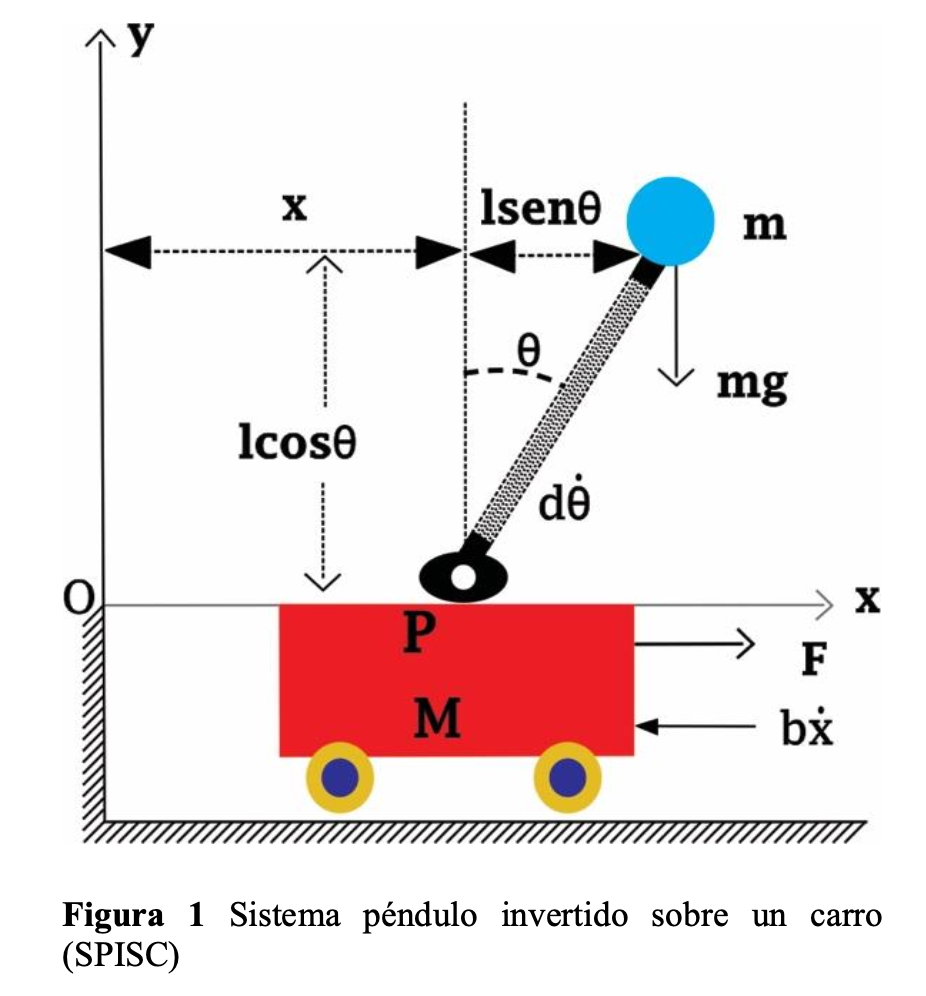
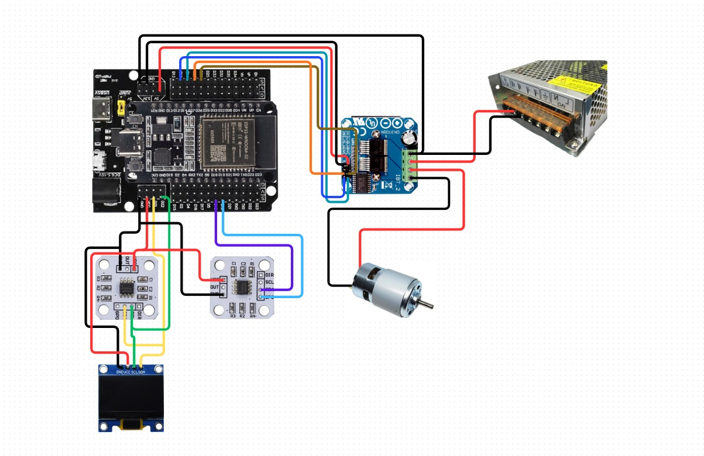
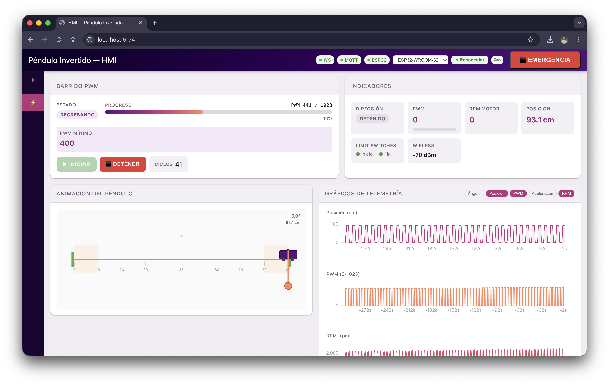

<p align="center">
  
</p>

<h1 align="center">Péndulo Invertido sobre Riel Lineal — SPISC</h1>

<p align="center">
  <strong>Sistema de Péndulo Invertido con Supervisión y Control</strong><br>
  Plataforma experimental para investigación y comparación de estrategias de control en tiempo real.
</p>

<p align="center">
  
  
  
  
  
  
</p>

---

## Descripción

Proyecto de ingeniería que implementa un **péndulo invertido sobre riel lineal** controlado por un ESP32, con una interfaz HMI web para supervisión y experimentación en tiempo real. La comunicación entre el microcontrolador y la interfaz es completamente inalámbrica (WiFi + MQTT).

El sistema permite:

- Ejecutar y comparar múltiples estrategias de control (PID, redes neuronales, SMC, LQR, fuzzy, etc.)
- Visualizar telemetría en tiempo real con gráficos de alta frecuencia (~50 Hz)
- Controlar el prototipo desde el navegador (modos, calibración, parámetros, parada de emergencia)
- Ejecutar experiments automatizados (barrido de rango PWM, caracterización)
- Simular el sistema completo sin hardware mediante un mock con modelo físico

<p align="center">
  
</p>

---

## Tabla de contenidos

- [Arquitectura](#arquitectura)
- [Hardware](#hardware)
- [Estructura del proyecto](#estructura-del-proyecto)
- [Requisitos](#requisitos)
- [Instalación](#instalación)
- [Guía de uso rápido](#guía-de-uso-rápido)
- [HMI Web](#hmi-web)
- [Firmware ESP32](#firmware-esp32)
- [Modos de control](#modos-de-control)
- [Roadmap](#roadmap)
- [Licencia](#licencia)

---

## Arquitectura

```
   ESP32 (WiFi)          Mosquitto           FastAPI            Vue.js 3
  ┌──────────────┐     ┌───────────┐     ┌────────────┐     ┌────────────┐
  │  Telemetría  │─ M ─►           │─ M ─►            │─ WS ─►            │
  │  Estado      │─ Q ─► Broker    │─ Q ─► Backend    │─────► Frontend   │
  │  Resultados  │─ T ─► :1883     │─ T ─► :8000      │     │ :5173      │
  │              │─ T ─►           │─ T ─►            │     │            │
  │  Comandos    │◄────│           │◄────│            │◄────│            │
  └──────────────┘     └───────────┘     └────────────┘     └────────────┘
       WiFi               TCP               HTTP/WS          Navegador
```

1. El **ESP32** publica telemetría y estado por MQTT vía WiFi.
2. **Mosquitto** (broker) enruta mensajes entre los nodos.
3. El **Backend** (FastAPI) se suscribe a `pendulum/#`, almacena en SQLite y reenvía por **WebSocket**.
4. El **Frontend** (Vue.js) renderiza gráficos en tiempo real, animación del carro y paneles de control.
5. Los **comandos** del usuario viajan en sentido inverso: Frontend → WS → Backend → MQTT → ESP32.

> **Principio de seguridad:** La protección es **local al ESP32**. Limit switches, timeouts y límites de ángulo/posición funcionan independientemente de WiFi/MQTT. La HMI supervisa y controla, pero el ESP32 se protege solo.

---

## Hardware

<p align="center">
  
</p>

| Componente | Modelo | Interfaz |
|---|---|---|
| Microcontrolador | ESP32-WROOM-32 DevKitC | — |
| Motor driver | BTS7960 (H-Bridge, PWM 25 kHz, 10-bit) | GPIO 12, 14, 26, 27 |
| Encoder ángulo | AS5600 magnético absoluto 12-bit | I2C Bus 0 (0x36) |
| Encoder posición | AS5600 magnético multi-vuelta | I2C Bus 1 (0x36) |
| Encoder IR (motor) | HC-020K (opción para posición) | GPIO 16 |
| Pantalla | OLED SSD1306 128×64 | I2C Bus 1 (0x3C) |
| Limit switches | XV-152-1C25 × 2 (NC + Pull-Up) | GPIO 32, 33 |
| IMU (opcional) | MPU6050 | I2C Bus 0 (0x68) |

### Mapa de GPIOs

| GPIO | Función | GPIO | Función |
|------|---------|------|---------|
| 12 | L_PWM (BTS7960) | 21 | I2C SDA Bus 0 |
| 13 | LED debug | 22 | I2C SCL Bus 0 |
| 14 | R_PWM (BTS7960) | 26 | R_EN (BTS7960) |
| 16 | Encoder IR HC-020K | 27 | L_EN (BTS7960) |
| 18 | I2C SDA Bus 1 | 32 | Limit Switch INICIO |
| 19 | I2C SCL Bus 1 | 33 | Limit Switch FIN |

### Especificaciones de la pista

- **Recorrido útil:** ~90 cm
- **Constante encoder magnético:** 0.0115780 cm/grado
- **Constante encoder IR:** 0.0992 cm/pulso (calibrada)
- **Rango operativo PWM:** 200–700 (por debajo de 200 el motor no se mueve)

---

## Estructura del proyecto

```
pendulo_invertido/
│
├── SPISC/                          # Firmware ESP32 (PlatformIO)
│   ├── platformio.ini              # Config multi-entorno
│   ├── include/
│   │   ├── wifi_mqtt_config.h      # Credenciales WiFi + MQTT (no versionado)
│   │   ├── hardware_pins.h         # Definición de pines GPIO
│   │   ├── telemetry_data.h        # Estructuras de telemetría unificada
│   │   ├── motor_control.h         # Control del motor BTS7960
│   │   ├── sensors_i2c.h           # Sensores I2C (AS5600, MPU6050)
│   │   ├── encoder_ir.h            # Encoder infrarrojo HC-020K
│   │   ├── limit_switches.h        # Interruptores de límite
│   │   ├── mqtt_comm.h             # Comunicación MQTT
│   │   ├── display_oled.h          # Pantalla OLED SSD1306
│   │   ├── safety.h                # Módulo de seguridad
│   │   └── time_sync.h             # Sincronización de tiempo
│   ├── lib/
│   │   ├── MqttBridge/             # Librería WiFi + MQTT reusable
│   │   ├── Neural_Networks_FF/     # Red neuronal feedforward
│   │   └── Dynamic_Array/          # Arreglos dinámicos
│   └── src/
│       ├── main.cpp                # Orquestador dual-core
│       ├── modes/                  # Modos de control modulares
│       │   ├── lazo_abierto_mode.h/cpp
│       │   ├── rango_pwm_mode.h/cpp
│       │   ├── pid_posicion_mode.h/cpp
│       │   ├── pid_angulo_mode.h/cpp
│       │   └── pid_cascada_mode.h/cpp
│       ├── main.cpp                # Orquestador dual-core
│       ├── motor_control.cpp       # Implementación motor
│       ├── sensors_i2c.cpp         # Lectura de sensores
│       ├── encoder_ir.cpp          # Encoder infrarrojo
│       ├── limit_switches.cpp      # Limit switches
│       ├── mqtt_comm.cpp           # Publicación MQTT
│       ├── display_oled.cpp        # Renderizado OLED
│       ├── safety.cpp              # Lógica de seguridad
│       ├── neural_control.cpp      # Control neuronal (experimental)
│       └── time_sync.cpp           # Sincronización NTP
│
├── hmi/                            # Interfaz HMI Web
│   ├── backend/                    # FastAPI + aiomqtt + SQLite
│   │   ├── app.py                  # Endpoints REST/WebSocket
│   │   ├── config.py               # Configuración y tópicos MQTT
│   │   ├── modelos.py              # Schemas Pydantic
│   │   ├── mqtt_cliente.py         # Cliente MQTT async
│   │   ├── websocket_manager.py    # Gestor WebSocket
│   │   └── registro_datos.py       # Persistencia SQLite
│   ├── frontend/                   # Vue.js 3 + Pinia + uPlot
│   │   └── src/
│   │       ├── stores/pendulumStore.js
│   │       ├── composables/useWebSocket.js
│   │       └── components/
│   │           ├── tabs/           # Pestañas de experimentos
│   │           │   ├── TabRangoPWM.vue
│   │           │   ├── TabLazoAbierto.vue
│   │           │   ├── TabControlPidPosicion.vue
│   │           │   └── TabControlPidAngulo.vue
│   │           ├── AnimacionPendulo.vue
│   │           ├── GraficosTelemetria.vue
│   │           └── PanelControl.vue
│   ├── mock/                       # Simulador físico del péndulo
│   ├── mosquitto/                  # Config del broker MQTT
│   └── README.md                   # Documentación detallada del HMI
│
├── scripts/                        # Scripts Arduino de referencia
│   ├── Encoder_test/               # Subproyecto PlatformIO (encoder + motor)
│   ├── control_neuronal.ino        # Control neuronal (versión .ino)
│   ├── pendulo_pid_final.ino       # PID cascada
│   └── ...                         # Tests de sensores y actuadores
│
├── docs/                           # Documentación técnica
│   ├── plan_mejoras.md             # Plan de fases de desarrollo
│   ├── control_pid_posicion.md     # Documentación del PID posición
│   ├── control_pid_angulo.md       # Documentación del PID ángulo
│   ├── control_pid_cascada.md      # Documentación del PID cascada
│   ├── calibracion_posicion_ir.md  # Calibración encoder IR
│   ├── calibracion_posicion_mag.md # Calibración encoder magnético
│   ├── config_dual_core.md         # Arquitectura dual-core
│   ├── plan_dual_core.md           # Plan de implementación dual-core
│   ├── plan_pipeline_telemetria.md # Arquitectura del pipeline de telemetría
│   ├── plan_wifi_ap.md             # Plan para modo WiFi AP
│   └── DeepResearch_ProblemaDeEncoder_IR.pdf  # Investigación técnica encoder IR
│
├── datas/                          # Datos de experimentos (29+ CSVs)
├── logs/                           # Logs de resultados de experimentos (.md)
└── img/                            # Fotos y esquemas del prototipo
```

---

## Requisitos

| Herramienta | Versión mínima | Uso |
|---|---|---|
| Python | 3.10+ | Backend + simulador mock |
| Node.js | 18+ | Frontend Vue.js |
| Mosquitto | 2.x | Broker MQTT |
| PlatformIO | 6.x | Compilar y flashear firmware |
| Navegador moderno | Chrome / Firefox / Edge | HMI web |

---

## Instalación

Todos los comandos desde la raíz del proyecto. Se requiere tener instalados Python 3.10+, Node.js 18+ y Mosquitto 2.x.

### 1. Clonar el repositorio

```bash
git clone <URL_DEL_REPOSITORIO>
cd pendulo_invertido
```

### 2. Broker MQTT

Mosquitto es el bus de mensajes central del sistema. Todos los nodos (ESP32, backend, frontend) se comunican a través de él, por lo que debe estar corriendo antes que cualquier otro componente.

```bash
# macOS
brew install mosquitto

# Ubuntu / Debian
sudo apt install mosquitto mosquitto-clients
```

### 3. Entorno Python

El directorio `cenv/` contiene un entorno Conda preconfigurado con todas las dependencias Python (FastAPI, aiomqtt, aiosqlite, PlatformIO, etc.). Si prefieres no usarlo, crea tu propio entorno virtual e instala las dependencias manualmente.

```bash
# Opción A — Usar el entorno preconfigurado (recomendado)
# El entorno ya está listo; los pasos siguientes lo usan directamente.

# Opción B — Crear entorno manual
python -m venv .venv && source .venv/bin/activate
pip install -r hmi/backend/requirements.txt
```

### 4. Backend Python

Instala las dependencias del servidor FastAPI (solo necesario si no usas `cenv/` o al actualizar el proyecto):

```bash
./cenv/bin/pip install -r hmi/backend/requirements.txt
```

Las dependencias principales son: `fastapi`, `uvicorn`, `aiomqtt`, `aiosqlite`, `pydantic`, `orjson`.

### 5. Frontend Vue.js

Instala los paquetes npm del frontend (Node.js 18+ requerido):

```bash
cd hmi/frontend && npm install
```

Esto descarga Vue.js 3.5, Pinia, uPlot y Vite. Solo es necesario la primera vez o al actualizar `package.json`.

### 6. PlatformIO (solo si compilas firmware)

PlatformIO gestiona el toolchain de compilación y flasheo del ESP32. Solo es necesario si vas a trabajar con el firmware:

```bash
./cenv/bin/pip install platformio
```

### 7. Credenciales WiFi (solo firmware real)

El archivo de credenciales **no está versionado** (está en `.gitignore`) para evitar exponer datos sensibles. Debes crearlo manualmente antes de compilar:

```bash
# Crear el archivo de credenciales
cp SPISC/include/wifi_mqtt_config.h.example SPISC/include/wifi_mqtt_config.h
# Luego editar con tus datos reales
```

Contenido del archivo:

```c
#define WIFI_SSID       "TU_RED_WIFI"
#define WIFI_PASSWORD   "TU_CONTRASEÑA"
#define MQTT_BROKER     "IP_DE_TU_PC"   // IP local de la máquina con el broker
#define MQTT_PORT       1883
```

### 8. Verificación

Para comprobar que todo está listo antes de arrancar:

```bash
# Verificar broker (debe iniciar sin errores)
mosquitto -c hmi/mosquitto/mosquitto.conf -v

# Verificar backend (debe responder en :8000)
./cenv/bin/uvicorn hmi.backend.app:app --port 8000
# → Abrir http://localhost:8000/docs

# Verificar frontend (debe compilar sin errores)
cd hmi/frontend && npm run build
```

---

## Guía de uso rápido

El sistema puede operar en dos modos: con el **hardware real** (ESP32 conectado por WiFi) o con el **simulador mock** (modelo físico por software, sin necesidad de hardware). Ambos flujos requieren el broker, el backend y el frontend.

> **Orden de arranque importante:** el broker MQTT debe estar corriendo antes que el backend, ya que este se conecta a él al iniciar. El frontend puede arrancar en cualquier momento.

### Flujo A — Con hardware real (ESP32)

Se necesitan **3 terminales**. Todas desde la raíz del proyecto.

```bash
# Terminal 1 — Broker MQTT (arrancar primero)
mosquitto -c hmi/mosquitto/mosquitto.conf -v
# Queda escuchando en :1883. Los mensajes aparecen en pantalla para debug.

# Terminal 2 — Backend FastAPI
./cenv/bin/uvicorn hmi.backend.app:app --host 0.0.0.0 --port 8000
# API REST en :8000, WebSocket en ws://localhost:8000/ws

# Terminal 3 — Frontend Vue.js
cd hmi/frontend && npm run dev
# UI disponible en http://localhost:5173
```

Luego, con el ESP32 ya flasheado y conectado a la misma red WiFi, al encenderlo se conectará automáticamente al broker. La HMI mostrará el indicador de **ESP32 conectado** y la telemetría comenzará a fluir.

Para compilar y flashear el firmware al ESP32:

```bash
cd SPISC

# Test de conectividad WiFi+MQTT (útil para verificar credenciales)
../cenv/bin/pio run -e test_connectivity -t upload

# Firmware principal (todos los modos de control)
../cenv/bin/pio run -e esp32dev -t upload

# Barrido de rango PWM (standalone, sin HMI)
../cenv/bin/pio run -e rango_pwm -t upload
```

### Flujo B — Sin hardware (modo mock/simulador)

El simulador replica el comportamiento físico del péndulo mediante un modelo matemático. Ideal para desarrollo y pruebas de la HMI sin necesitar el prototipo físico.

Se necesitan **4 terminales**:

```bash
# Terminal 1 — Broker MQTT
mosquitto -c hmi/mosquitto/mosquitto.conf -v

# Terminal 2 — Backend FastAPI
./cenv/bin/uvicorn hmi.backend.app:app --host 0.0.0.0 --port 8000

# Terminal 3 — Frontend Vue.js
cd hmi/frontend && npm run dev

# Terminal 4 — Simulador físico (reemplaza al ESP32)
./cenv/bin/python -m hmi.mock.simulador_pendulo
# Publica telemetría simulada en los mismos tópicos MQTT que el ESP32 real.
```

Abrir **http://localhost:5173** en el navegador.

### Comandos útiles

```bash
# Monitorear todos los mensajes MQTT en tiempo real
mosquitto_sub -t "pendulum/#" -v

# Consultar el estado actual del sistema vía API REST
curl -s http://localhost:8000/api/estado | python3 -m json.tool

# Explorar todos los endpoints disponibles (Swagger UI)
# → http://localhost:8000/docs

# Apagar todos los servicios en background
pkill mosquitto; pkill -f uvicorn
```

---

## HMI Web

<p align="center">
  
</p>

### Stack tecnológico

| Capa | Tecnología | Descripción |
|---|---|---|
| Frontend | Vue.js 3.5 + Pinia 2.3 + uPlot 1.6 | UI reactiva con gráficos de alto rendimiento |
| Backend | FastAPI 0.115 + aiomqtt 2.3 + aiosqlite 0.21 | API REST + WebSocket + logging async |
| Broker | Mosquitto 2.x | Enrutamiento MQTT |
| Base de datos | SQLite (async) | Telemetría + registro de eventos |

### Funcionalidades

- **Telemetría en tiempo real** con gráficos uPlot (~50 Hz)
- **Animación SVG** del carro + péndulo + pista + limit switches
- **Panel de conexión** con indicadores WS / MQTT / ESP32
- **Parada de emergencia** desde cualquier pantalla
- **Editor de parámetros** para configuración dinámica del controlador (Kp, Ki, Kd, setpoints)
- **Exportación CSV** de datos experimentales
- **Modo mock** con simulador de física para desarrollo sin hardware

### Pestañas de experimentos

| Tab | Descripción |
|-----|-------------|
| **Barrido PWM** | Barrido automático e incremental del rango operativo del motor (200–700 PWM). Genera una tabla de respuesta para caracterizar la zona muerta y el comportamiento dinámico. |
| **Lazo Abierto** | Control PWM directo sin realimentación. Permite enviar comandos de movimiento manuales y verificar la respuesta del motor. Incluye homing automático al inicio. |
| **PID Posición** | PID discreto para posicionar el carro en la pista. Ganancias Kp, Ki, Kd configurables en vivo. Sensor seleccionable: encoder magnético AS5600 o encoder IR HC-020K. |
| **PID Ángulo** | PID para estabilizar el péndulo en posición vertical (0°). Incluye pre-posicionamiento automático del carro y telemetría extendida del error, integral y derivada. |
| **PID Cascada** | Control de doble lazo: el lazo exterior controla el ángulo y genera el setpoint de posición para el lazo interior. Estrategia más avanzada para el equilibrio completo del péndulo. |

> La documentación completa del HMI está en [`hmi/README.md`](hmi/README.md).

---

## Firmware ESP32

El proyecto PlatformIO (`SPISC/`) implementa una **arquitectura dual-core** para separar las tareas críticas de control de las comunicaciones:

### Arquitectura Dual-Core

```
┌─────────────────────────────────────────────────────────────┐
│  CORE 0 — Sensores y Control (1000 Hz, crítico)            │
│    - Lectura de sensores cada 1ms                          │
│    - Procesamiento de comandos MQTT (desde cola)           │
│    - Verificación de seguridad y límites                   │
│    - Ejecución de modos de control                         │
│    - Watchdog de seguridad                                 │
└─────────────────────────────────────────────────────────────┘
┌─────────────────────────────────────────────────────────────┐
│  CORE 1 — Comunicación (flexible, no crítico)              │
│    - MQTT keep-alive y reconexión                          │
│    - Publicación de telemetría (5 Hz)                      │
│    - Publicación de estado (2 Hz)                          │
│    - Actualización de OLED (2 Hz)                          │
└─────────────────────────────────────────────────────────────┘
```

### Entornos de compilación

| Entorno | Archivo | Descripción |
|---|---|---|
| `esp32dev` | `main.cpp` | Firmware principal modular — todos los modos de control |
| `rango_pwm` | `rango_pwm.cpp` | Barrido incremental de rango operativo PWM (standalone) |
| `test_connectivity` | `test_connectivity.cpp` | Verificación de conexión WiFi + MQTT |

### Librerías propias

| Librería | Descripción |
|---|---|
| **MqttBridge** | Gestión WiFi + MQTT con auto-reconnect y publicación JSON |
| **Neural_Networks_FF** | Red neuronal feedforward con entrenamiento online (backpropagation) |
| **Dynamic_Array** | Arreglos dinámicos para soporte de la red neuronal |

---

## Modos de control

El sistema utiliza una arquitectura modular (Strategy pattern) para soportar múltiples estrategias de control intercambiables en runtime vía MQTT:

### Modos implementados

| Modo | Enum | Descripción | Estado |
|---|---|---|---|
| **Lazo Abierto** | `MODE_OPEN_LOOP` | Movimientos controlados con homing automático | ✅ Completo |
| **Barrido PWM** | `MODE_SWEEP_PWM` | Caracterización del rango operativo del motor | ✅ Completo |
| **PID Posición** | `MODE_PID_POS` | Control PID discreto para posicionar el carro | ✅ Completo |
| **PID Ángulo** | `MODE_PID_ANG` | PID de ángulo para estabilización vertical del péndulo | ✅ Completo |
| **PID Cascada** | `MODE_PID_CASCADE` | Doble lazo (ángulo + posición) para equilibrio completo | ✅ Completo |
| **Idle** | `MODE_IDLE` | Estado de reposo, motor detenido | ✅ Completo |

### Modos planificados

| Modo | Enum | Descripción |
|---|---|---|
| **Manual** | `MODE_MANUAL` | Control directo de PWM desde la HMI |
| **Red Neuronal FF** | `MODE_NEURAL` | Red 3→3→1 con entrenamiento online |
| **SMC** | `MODE_SMC` | Régimen deslizante — robusto ante perturbaciones |
| **LQR** | `MODE_LQR` | Regulador cuadrático lineal — control óptimo |
| **Fuzzy** | `MODE_FUZZY` | Control difuso basado en reglas heurísticas |
| **MRAC** | `MODE_MRAC` | Control adaptativo por modelo de referencia |
| **MPC** | `MODE_MPC` | Control predictivo con horizonte finito |

### Características del PID Posición

- Frecuencia de control: 1000 Hz (Core 0)
- Sensor configurable: AS5600 magnético o HC-020K infrarrojo
- Anti-windup con saturación de integral
- Filtro derivativo pasa-bajos (α = 0.2)
- Zonas de seguridad configurables
- Telemetría extendida: error, integral, derivada, salida, setpoint
- Configuración dinámica de ganancias Kp, Ki, Kd vía MQTT

> Documentación detallada en [`docs/control_pid_posicion.md`](docs/control_pid_posicion.md)

### Características del PID Ángulo

- Frecuencia de control: 1000 Hz (Core 0)
- Sensor: AS5600 magnético absoluto (12-bit)
- Normalización del error angular a [−180°, +180°] para manejar cruce 360°/0°
- Rango de trabajo configurable (±20° por defecto) con detección automática de entrada/salida
- Motor bias aditivo (300 PWM) para compensar la zona muerta del motor
- Anti-windup con saturación de integral ±500
- Filtro derivativo pasa-bajos (α = 0.2)
- PID de posición interno para pre-posicionamiento automático del carro a 45 cm
- Máquina de estados completa: IDLE → HOMING → CALIBRATING → PREPOSITIONING → READY → ACTIVE → STOPPED
- Telemetría extendida: error, integral, derivada, salida, setpoint (campos `pida_*`)
- Configuración dinámica de ganancias Kp, Ki, Kd y parámetros de control vía MQTT

> Documentación detallada en [`docs/control_pid_angulo.md`](docs/control_pid_angulo.md)

### Características del PID Cascada

- Frecuencia de control: 1000 Hz en ambos lazos (Core 0)
- Lazo exterior: PID de ángulo → genera setpoint de posición dinámico para el lazo interior
- Lazo interior: PID de posición → controla el PWM del motor para seguir el setpoint de ángulo
- Pre-posicionamiento automático del carro al centro de la pista antes de activar el balance
- Transición automática por máquina de estados: IDLE → HOMING → PREPOSITIONING → READY → ACTIVE → STOPPED
- Límites direccionales configurables para confinar el carro dentro de la zona de balance
- Tolerancia de posición configurable para el retorno automático al centro tras salir del balance
- Anti-windup en ambos lazos con saturación de integral independiente
- Telemetría extendida con campos de ambos controladores: `pid_*` (posición) y `pida_*` (ángulo)
- Configuración dinámica de todas las ganancias y parámetros vía MQTT

> Documentación detallada en [`docs/control_pid_cascada.md`](docs/control_pid_cascada.md)

---

## Documentación

| Documento | Descripción |
|---|---|
| [`docs/control_pid_posicion.md`](docs/control_pid_posicion.md) | Documentación completa del modo PID Posición |
| [`docs/control_pid_angulo.md`](docs/control_pid_angulo.md) | Documentación completa del modo PID Ángulo |
| [`docs/control_pid_cascada.md`](docs/control_pid_cascada.md) | Documentación completa del modo PID Cascada |
| [`docs/calibracion_posicion_ir.md`](docs/calibracion_posicion_ir.md) | Calibración del encoder infrarrojo HC-020K |
| [`docs/calibracion_posicion_mag.md`](docs/calibracion_posicion_mag.md) | Calibración del encoder magnético AS5600 |
| [`docs/config_dual_core.md`](docs/config_dual_core.md) | Configuración de la arquitectura dual-core |
| [`docs/plan_dual_core.md`](docs/plan_dual_core.md) | Plan de implementación dual-core |
| [`docs/plan_pipeline_telemetria.md`](docs/plan_pipeline_telemetria.md) | Arquitectura del pipeline de telemetría (ESP32 → MQTT → Backend → WS → Frontend) |
| [`docs/plan_mejoras.md`](docs/plan_mejoras.md) | Roadmap general del proyecto |
| [`docs/plan_wifi_ap.md`](docs/plan_wifi_ap.md) | Plan para modo AP del WiFi |
| [`docs/DeepResearch_ProblemaDeEncoder_IR.pdf`](docs/DeepResearch_ProblemaDeEncoder_IR.pdf) | Investigación técnica sobre el problema del encoder IR HC-020K |
| [`hmi/README.md`](hmi/README.md) | Documentación completa del HMI Web |

---

## Roadmap

| Fase | Descripción | Estado |
|---|---|---|
| **1** | Limit switches XV-152-1C25 — calibración + seguridad fail-safe | ✅ Completado |
| **2** | Encoder IR HC-020K — medición de RPM del motor | ✅ Completado |
| **3** | Encoder magnético AS5600 — posición precisa del carro | ✅ Completado |
| **4** | HMI Web (Vue.js + MQTT + FastAPI) | ✅ Activo (v0.3.0) |
| **5** | Arquitectura dual-core ESP32 (Core 0: control, Core 1: comunicación) | ✅ Completado |
| **6** | Control PID de Posición con telemetría extendida | ✅ Completado |
| **7** | Control PID de Ángulo con bias de motor y pre-posicionamiento | ✅ Completado |
| **8** | Control PID Cascada (ángulo + posición) para equilibrio completo | ✅ Completado |
| **9** | Controladores avanzados (SMC, LQR, MPC) | Planificado |
| **10** | Red neuronal con entrenamiento online | Planificado |

> El detalle completo de cada fase está en [`docs/plan_mejoras.md`](docs/plan_mejoras.md).

---

## Licencia

Proyecto académico de ingeniería. Consultar con el autor para uso o distribución.

---

<p align="center">
  <sub>Ing. Jeisson Martinez — Junio 2026</sub>
</p>
