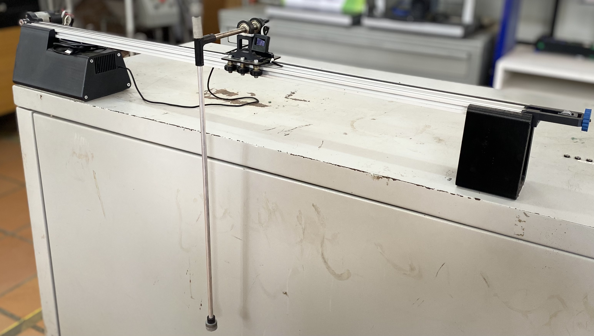

<p align="center">
  
</p>

<h1 align="center">Péndulo Invertido sobre Riel Lineal — SPISC</h1>

<p align="center">
  <strong>Sistema de Péndulo Invertido con Supervisión y Control</strong><br>
  Plataforma experimental para investigación y comparación de estrategias de control en tiempo real.
</p>

<p align="center">
  
  
  
  
  
  
</p>

---

## Descripción

Proyecto de ingeniería que implementa un **péndulo invertido sobre riel lineal** controlado por un ESP32, con una interfaz HMI web para supervisión y experimentación en tiempo real. La comunicación entre el microcontrolador y la interfaz es completamente inalámbrica (WiFi + MQTT).

El sistema permite:

- Ejecutar y comparar múltiples estrategias de control (PID, redes neuronales, SMC, LQR, fuzzy, etc.)
- Visualizar telemetría en tiempo real con gráficos de alta frecuencia (~50 Hz)
- Controlar el prototipo desde el navegador (modos, calibración, parámetros, parada de emergencia)
- Ejecutar experiments automatizados (barrido de rango PWM, caracterización)
- Simular el sistema completo sin hardware mediante un mock con modelo físico

<p align="center">
  
</p>

---

## Tabla de contenidos

- [Arquitectura](#arquitectura)
- [Hardware](#hardware)
- [Estructura del proyecto](#estructura-del-proyecto)
- [Requisitos](#requisitos)
- [Instalación](#instalación)
- [Guía de uso rápido](#guía-de-uso-rápido)
- [HMI Web](#hmi-web)
- [Firmware ESP32](#firmware-esp32)
- [Modos de control](#modos-de-control)
- [Roadmap](#roadmap)
- [Licencia](#licencia)

---

## Arquitectura

```
   ESP32 (WiFi)          Mosquitto           FastAPI            Vue.js 3
  ┌──────────────┐     ┌───────────┐     ┌────────────┐     ┌────────────┐
  │  Telemetría  │─ M ─►           │─ M ─►            │─ WS ─►            │
  │  Estado      │─ Q ─► Broker    │─ Q ─► Backend    │─────► Frontend   │
  │  Resultados  │─ T ─► :1883     │─ T ─► :8000      │     │ :5173      │
  │              │─ T ─►           │─ T ─►            │     │            │
  │  Comandos    │◄────│           │◄────│            │◄────│            │
  └──────────────┘     └───────────┘     └────────────┘     └────────────┘
       WiFi               TCP               HTTP/WS          Navegador
```

1. El **ESP32** publica telemetría y estado por MQTT vía WiFi.
2. **Mosquitto** (broker) enruta mensajes entre los nodos.
3. El **Backend** (FastAPI) se suscribe a `pendulum/#`, almacena en SQLite y reenvía por **WebSocket**.
4. El **Frontend** (Vue.js) renderiza gráficos en tiempo real, animación del carro y paneles de control.
5. Los **comandos** del usuario viajan en sentido inverso: Frontend → WS → Backend → MQTT → ESP32.

> **Principio de seguridad:** La protección es **local al ESP32**. Limit switches, timeouts y límites de ángulo/posición funcionan independientemente de WiFi/MQTT. La HMI supervisa y controla, pero el ESP32 se protege solo.

---

## Hardware

<p align="center">
  
</p>

| Componente | Modelo | Interfaz |
|---|---|---|
| Microcontrolador | ESP32-WROOM-32 DevKitC | — |
| Motor driver | BTS7960 (H-Bridge, PWM 25 kHz, 10-bit) | GPIO 12, 14, 26, 27 |
| Encoder ángulo | AS5600 magnético absoluto 12-bit | I2C Bus 0 (0x36) |
| Encoder posición | AS5600 magnético multi-vuelta | I2C Bus 1 (0x36) |
| Pantalla | OLED SSD1306 128×64 | I2C Bus 0 (0x3C) |
| Limit switches | XV-152-1C25 × 2 (NC + Pull-Up) | GPIO 32, 33 |
| Encoder IR (motor) | HC-020K (20 PPR) | GPIO 16 |

### Mapa de GPIOs

| GPIO | Función | GPIO | Función |
|------|---------|------|---------|
| 12 | L_PWM (BTS7960) | 21 | I2C SDA Bus 0 |
| 13 | LED debug | 22 | I2C SCL Bus 0 |
| 14 | R_PWM (BTS7960) | 26 | R_EN (BTS7960) |
| 16 | Encoder IR HC-020K | 27 | L_EN (BTS7960) |
| 18 | I2C SDA Bus 1 | 32 | Limit Switch INICIO |
| 19 | I2C SCL Bus 1 | 33 | Limit Switch FIN |

### Especificaciones de la pista

- **Recorrido útil:** ~90 cm
- **Constante encoder:** 0.0504 cm/pulso
- **Rango operativo PWM:** 250–800 (por debajo de 250 el motor no se mueve)

---

## Estructura del proyecto

```
Proyecto_pendulo_invertido/
│
├── SPISC/                          # Firmware ESP32 (PlatformIO)
│   ├── platformio.ini              # Config multi-entorno
│   ├── include/
│   │   └── wifi_mqtt_config.h      # Credenciales WiFi + MQTT (no versionado)
│   ├── lib/
│   │   ├── MqttBridge/             # Librería WiFi + MQTT reusable
│   │   ├── Neural_Networks_FF/     # Red neuronal feedforward
│   │   └── Dynamic_Array/          # Arreglos dinámicos
│   └── src/
│       ├── main.cpp                # Firmware principal (OLED + AS5600 + control)
│       ├── rango_pwm.cpp           # Barrido automático de rango PWM
│       └── test_connectivity.cpp   # Test WiFi + MQTT
│
├── hmi/                            # Interfaz HMI Web
│   ├── backend/                    # FastAPI + aiomqtt + SQLite
│   ├── frontend/                   # Vue.js 3 + Pinia + uPlot
│   ├── mock/                       # Simulador físico del péndulo
│   ├── mosquitto/                  # Config del broker MQTT
│   └── README.md                   # Documentación detallada del HMI
│
├── scripts/                        # Scripts Arduino de referencia
│   ├── Encoder_test/               # Subproyecto PlatformIO (encoder + motor)
│   ├── control_neuronal.ino        # Control neuronal (versión .ino)
│   ├── pendulo_pid_final.ino       # PID cascada
│   ├── test_limit_switches.ino     # Test de limit switches
│   ├── test_mpu6050.ino            # Test de IMU MPU6050
│   └── ...                         # Tests de sensores y actuadores
│
├── docs/
│   └── plan_mejoras.md             # Plan de fases de desarrollo
│
└── img/                            # Fotos y esquemas del prototipo
```

---

## Requisitos

| Herramienta | Versión mínima | Uso |
|---|---|---|
| Python | 3.10+ | Backend + simulador mock |
| Node.js | 18+ | Frontend Vue.js |
| Mosquitto | 2.x | Broker MQTT |
| PlatformIO | 6.x | Compilar y flashear firmware |
| Navegador moderno | Chrome / Firefox / Edge | HMI web |

---

## Instalación

Todos los comandos desde la raíz del proyecto.

### 1. Broker MQTT

```bash
# macOS
brew install mosquitto

# Ubuntu / Debian
sudo apt install mosquitto mosquitto-clients
```

### 2. Backend Python

```bash
./cenv/bin/pip install -r hmi/backend/requirements.txt
```

### 3. Frontend Vue.js

```bash
cd hmi/frontend && npm install
```

### 4. PlatformIO (solo si compilas firmware)

```bash
./cenv/bin/pip install platformio
```

### 5. Credenciales WiFi (solo firmware real)

Crear/editar `SPISC/include/wifi_mqtt_config.h`:

```c
#define WIFI_SSID       "TU_RED_WIFI"
#define WIFI_PASSWORD   "TU_CONTRASEÑA"
#define MQTT_BROKER     "IP_DE_TU_PC"
#define MQTT_PORT       1883
```

---

## Guía de uso rápido

Se necesitan **3 terminales** (4 si se usa el mock). Todas desde la raíz del proyecto.

```bash
# Terminal 1 — Broker MQTT
mosquitto -c hmi/mosquitto/mosquitto.conf -d

# Terminal 2 — Backend
./cenv/bin/uvicorn hmi.backend.app:app --host 0.0.0.0 --port 8000

# Terminal 3 — Frontend
cd hmi/frontend && npm run dev

# Terminal 4 (opcional) — Mock (reemplaza al ESP32)
./cenv/bin/python -m hmi.mock.simulador_pendulo
```

Abrir **http://localhost:5173** en el navegador.

### Compilar y flashear firmware

```bash
cd SPISC

# Barrido de rango PWM
../cenv/bin/pio run -e rango_pwm -t upload

# Test de conectividad WiFi+MQTT
../cenv/bin/pio run -e test_connectivity -t upload

# Firmware principal
../cenv/bin/pio run -e esp32dev -t upload
```

### Comandos útiles

```bash
# Debug MQTT en tiempo real
mosquitto_sub -t "pendulum/#" -v

# Estado del sistema vía API
curl -s http://localhost:8000/api/estado | python3 -m json.tool

# Documentación Swagger
# http://localhost:8000/docs

# Apagar servicios
pkill mosquitto; pkill -f uvicorn
```

---

## HMI Web

<p align="center">
  
</p>

### Stack tecnológico

| Capa | Tecnología | Descripción |
|---|---|---|
| Frontend | Vue.js 3 + Pinia + uPlot | UI reactiva con gráficos de alto rendimiento |
| Backend | FastAPI + aiomqtt + aiosqlite | API REST + WebSocket + logging async |
| Broker | Mosquitto | Enrutamiento MQTT |
| Base de datos | SQLite (async) | Telemetría + registro de eventos |

### Funcionalidades

- **Telemetría en tiempo real** con gráficos uPlot (~50 Hz)
- **Animación SVG** del carro + péndulo + pista + limit switches
- **Panel de conexión** con indicadores WS / MQTT / ESP32
- **Navegación por tabs** para diferentes experimentos
- **Barrido PWM** automatizado con tabla de resultados + exportación CSV
- **Parada de emergencia** desde cualquier pantalla
- **Modo mock** con simulador de física para desarrollo sin hardware

> La documentación completa del HMI está en [`hmi/README.md`](hmi/README.md).

---

## Firmware ESP32

El proyecto PlatformIO (`SPISC/`) contiene múltiples entornos de compilación:

| Entorno | Archivo | Descripción |
|---|---|---|
| `esp32dev` | `main.cpp` | Firmware principal — control neuronal FF + swing-up + OLED |
| `rango_pwm` | `rango_pwm.cpp` | Barrido incremental de rango operativo PWM vía MQTT |
| `test_connectivity` | `test_connectivity.cpp` | Verificación de conexión WiFi + MQTT |

### Librerías propias

| Librería | Descripción |
|---|---|
| **MqttBridge** | Gestión WiFi + MQTT con auto-reconnect y publicación JSON |
| **Neural_Networks_FF** | Red neuronal feedforward con entrenamiento online (backpropagation) |
| **Dynamic_Array** | Arreglos dinámicos para soporte de la red neuronal |

---

## Modos de control

El sistema está diseñado para soportar múltiples estrategias de control intercambiables en runtime:

| Modo | Estado | Descripción |
|---|---|---|
| **Manual** | Planificado | Control directo de PWM desde la HMI |
| **PID Cascada** | Planificado | Lazo exterior (posición) + lazo interior (ángulo) |
| **Red Neuronal FF** | Implementado | Red 3→3→1 con entrenamiento online |
| **SMC** | Planificado | Régimen deslizante — robusto ante perturbaciones |
| **LQR** | Planificado | Regulador cuadrático lineal — control óptimo |
| **Fuzzy** | Planificado | Control difuso basado en reglas heurísticas |
| **MRAC** | Planificado | Control adaptativo por modelo de referencia |
| **MPC** | Planificado | Control predictivo con horizonte finito |

---

## Roadmap

| Fase | Descripción | Estado |
|---|---|---|
| **1** | Limit switches XV-152-1C25 — calibración + seguridad fail-safe | Documentado |
| **2** | Encoder IR HC-020K — medición de RPM del motor | Documentado |
| **3** | IMU MPU6050 — aceleración y orientación del carro | Documentado |
| **4** | HMI Web (Vue.js + MQTT + FastAPI) | **Activo** (v0.3.0) |
| **5** | Arquitectura modular de modos de control (Strategy pattern) | Planificado |

> El detalle completo de cada fase está en [`docs/plan_mejoras.md`](docs/plan_mejoras.md).

---

## Licencia

Proyecto académico de ingeniería. Consultar con el autor para uso o distribución.

---

<p align="center">
  <sub>Ing. Jeisson Martinez — 2026</sub>
</p>
