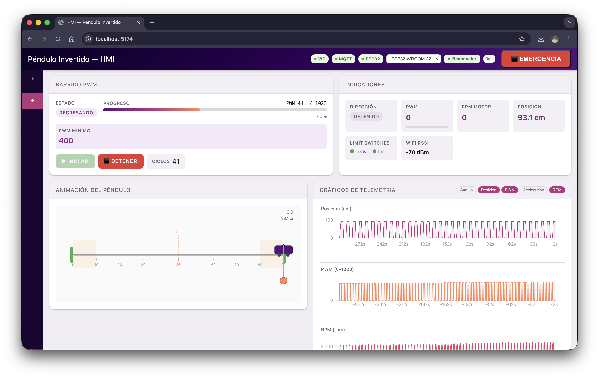

# HMI Web — Péndulo Invertido

Interfaz HMI web para supervisión y control en tiempo real del péndulo invertido sobre riel lineal.  
Permite ejecutar experimentos desde el navegador, visualizar telemetría en vivo y exportar resultados.

| Capa | Tecnología | Versión |
|------|-----------|---------|
| Frontend | Vue.js 3 + Pinia + uPlot | 3.5 / 2.3 / 1.6 |
| Backend | FastAPI + aiomqtt + aiosqlite | 0.115 / 2.3 / 0.21 |
| Broker MQTT | Mosquitto | 2.x |
| Firmware | ESP32 + PlatformIO (Arduino) | espressif32 |
| Base de datos | SQLite (async) | — |

---

## Tabla de contenidos

1. [Arquitectura general](#arquitectura-general)
2. [Hardware del prototipo](#hardware-del-prototipo)
3. [Requisitos de software](#requisitos-de-software)
4. [Instalación paso a paso](#instalación-paso-a-paso)
5. [Guía de uso: arrancar todo desde cero](#guía-de-uso-arrancar-todo-desde-cero)
6. [Modo Mock (sin hardware)](#modo-mock-sin-hardware)
7. [Modo Real (con ESP32)](#modo-real-con-esp32)
8. [Interfaz de usuario (HMI)](#interfaz-de-usuario-hmi)
9. [Experimento: Barrido de Rango PWM](#experimento-barrido-de-rango-pwm)
10. [Máquina de estados del barrido PWM](#máquina-de-estados-del-barrido-pwm)
11. [Tópicos MQTT](#tópicos-mqtt)
12. [API REST del backend](#api-rest-del-backend)
13. [Estructura de archivos](#estructura-de-archivos)
14. [Variables de entorno](#variables-de-entorno)
15. [Solución de problemas](#solución-de-problemas)
16. [Historial de cambios](#historial-de-cambios)

---

## Arquitectura general

```
   ESP32 (WiFi)          Mosquitto           FastAPI            Vue.js 3
  ┌──────────────┐     ┌───────────┐     ┌────────────┐     ┌────────────┐
  │  Telemetría  │─ M ─►           │─ M ─►            │─ WS ─►            │
  │  Estado      │─ Q ─► Broker    │─ Q ─► Backend    │─────► Frontend   │
  │  Resultados  │─ T ─► :1883     │─ T ─► :8000      │     │ :5173      │
  │              │─ T ─►           │─ T ─►            │     │            │
  │  Comandos    │◄────│           │◄────│            │◄────│            │
  └──────────────┘     └───────────┘     └────────────┘     └────────────┘
       WiFi               TCP               HTTP/WS          Navegador
```

**Flujo de datos:**

1. El **ESP32** publica telemetría y estado por MQTT vía WiFi.
2. **Mosquitto** (broker) enruta los mensajes.
3. El **Backend** (FastAPI) se suscribe a `pendulum/#`, almacena en SQLite y reenvía por **WebSocket** a los clientes conectados.
4. El **Frontend** (Vue.js) renderiza gráficos en tiempo real, animación del carro y paneles de control.
5. Los **comandos** del usuario viajan en sentido inverso: Frontend → WS → Backend → MQTT → ESP32.

> **Nota:** No se usa comunicación Serial. Toda la comunicación entre PC y ESP32 es inalámbrica (WiFi + MQTT).

---

## Hardware del prototipo

| Componente | Modelo | Pines ESP32 |
|-----------|--------|-------------|
| Microcontrolador | ESP32-WROOM-32 DevKitC | — |
| Motor DC + H-Bridge | BTS7960 | R_EN→26, L_EN→27, R_PWM→12, L_PWM→14 |
| Encoder óptico | HC-020K (40 PPR) | OUT→16 |
| Limit Switch inicio | XV-152-1C25 (NC + Pull-Up) | GPIO 32 |
| Limit Switch fin | XV-152-1C25 (NC + Pull-Up) | GPIO 33 |

### Configuración del motor

- **PWM:** 25 kHz, resolución 10 bits (0–1023)
- **Rango operativo real:** PWM 250–1023 (por debajo de 250 el motor no se mueve)
- **Constante encoder:** 0.0504 cm/pulso

---

## Requisitos de software

| Herramienta | Versión mínima | Nota |
|------------|---------------|------|
| Python | 3.10+ | Ya incluido como Conda env en `cenv/` |
| Node.js | 18+ | Con npm |
| Mosquitto | 2.x | Broker MQTT |
| PlatformIO | 6.x | Se instala vía pip: `./cenv/bin/pip install platformio` |
| Navegador | Chrome/Firefox/Edge moderno | Para la HMI web |

---

## Instalación paso a paso

Todos los comandos se ejecutan desde la raíz del proyecto: `Proyecto_pendulo_invertido/`

### 1. Broker MQTT (Mosquitto)

```bash
# macOS
brew install mosquitto

# Ubuntu / Debian
sudo apt install mosquitto mosquitto-clients
```

### 2. Backend Python

```bash
# Usando el entorno Conda del proyecto
./cenv/bin/pip install -r hmi/backend/requirements.txt
```

Si usas otro entorno virtual:
```bash
pip install -r hmi/backend/requirements.txt
```

### 3. Frontend Vue.js

```bash
cd hmi/frontend
npm install
```

### 4. PlatformIO (solo si vas a compilar firmware)

```bash
./cenv/bin/pip install platformio
```

### 5. Configurar credenciales WiFi (solo para firmware real)

Editar `SPISC/include/wifi_mqtt_config.h`:

```c
#define WIFI_SSID       "TU_RED_WIFI"
#define WIFI_PASSWORD   "TU_CONTRASEÑA"
#define MQTT_BROKER     "IP_DE_TU_PC"   // ej: "192.168.1.3"
#define MQTT_PORT       1883
```

> Para obtener la IP de tu PC: `ifconfig | grep "inet "` (macOS) o `hostname -I` (Linux).

---

## Guía de uso: arrancar todo desde cero

Esta es la guía completa para cuando enciendas el computador y quieras poner todo a funcionar. Se necesitan **4 terminales** abiertas desde la raíz del proyecto.

### Paso 1 — Iniciar Mosquitto (Terminal 1)

```bash
mosquitto -c hmi/mosquitto/mosquitto.conf -d
```

El flag `-d` lo ejecuta como daemon (en segundo plano). Para ver logs en tiempo real, quitar `-d` y usar `-v`:
```bash
mosquitto -c hmi/mosquitto/mosquitto.conf -v
```

**Verificar que está corriendo:**
```bash
pgrep -la mosquitto
```

### Paso 2 — Iniciar Backend (Terminal 2)

```bash
# Desde la raíz del proyecto
./cenv/bin/uvicorn hmi.backend.app:app --host 0.0.0.0 --port 8000
```

Deberías ver:
```
INFO:     Started server process [...]
INFO:     Waiting for application startup.
INFO:     Application startup complete.
INFO:     Uvicorn running on http://0.0.0.0:8000
```

**Verificar que responde:**
```bash
curl -s http://localhost:8000/api/estado | python3 -m json.tool
```

> Para desarrollo con recarga automática, agregar `--reload`.

### Paso 3 — Iniciar Frontend (Terminal 3)

```bash
cd hmi/frontend
npm run dev
```

Deberías ver:
```
  VITE v6.x.x  ready in XXXms

  ➜  Local:   http://localhost:5173/
  ➜  Network: http://192.168.x.x:5173/
```

**Abrir en el navegador:** http://localhost:5173

### Paso 4 — Compilar y subir firmware al ESP32 (Terminal 4)

```bash
cd SPISC
../cenv/bin/pio run -e rango_pwm -t upload
```

> ⚠ El ESP32 debe estar conectado por USB. Una vez flasheado, la comunicación de datos es por WiFi. El cable USB solo se necesita para programar y para alimentar (o usar fuente externa).

### Paso 5 — ¡Listo!

- Abre http://localhost:5173 en tu navegador.
- El **panel de conexión** (header) muestra 3 indicadores:
  - **WS** (verde) — Frontend conectado al backend por WebSocket.
  - **MQTT** (verde) — Backend conectado al broker Mosquitto.
  - **ESP32** (verde) — El ESP32 está enviando datos.
- Navega a la pestaña **Rango PWM** y presiona **INICIAR BARRIDO**.

### Comandos rápidos de referencia

```bash
# Ver temas MQTT en tiempo real (debug)
mosquitto_sub -t "pendulum/#" -v

# Ver solo telemetría
mosquitto_sub -t "pendulum/telemetry"

# Ver solo estado
mosquitto_sub -t "pendulum/status"

# Enviar un comando de start manual por MQTT (sin HMI)
mosquitto_pub -t "pendulum/cmd/sweep" -m '{"action":"start"}'

# Enviar stop manual
mosquitto_pub -t "pendulum/cmd/stop" -m '{}'

# Ver documentación Swagger del API
# Abrir en navegador: http://localhost:8000/docs

# Verificar qué servicios están corriendo
pgrep -la mosquitto && pgrep -la uvicorn

# Matar todo (cuando quieras apagar)
pkill mosquitto; pkill uvicorn
# El frontend se detiene con Ctrl+C en su terminal
```

---

## Modo Mock (sin hardware)

El simulador mock reemplaza al ESP32, publicando telemetría por MQTT con física simplificada del péndulo. Ideal para desarrollo y pruebas de la HMI sin el prototipo físico.

### Iniciar mock (Terminal adicional)

```bash
# Desde la raíz del proyecto
./cenv/bin/python -m hmi.mock.simulador_pendulo
```

### Qué simula

- Telemetría a ~50 Hz en `pendulum/telemetry`
- Estado a ~2 Hz en `pendulum/status`
- Responde a comandos en `pendulum/cmd/#`
- Estados simulados: IDLE, CALIBRATING, SWING_UP, CONTROLLING, EMERGENCY
- PID simplificado para modo CONTROLLING (ángulo ≈ 180°)

> **Importante:** No usar mock y ESP32 real al mismo tiempo, ambos publican en los mismos tópicos y los datos se mezclan.

---

## Modo Real (con ESP32)

### Firmware disponible

El firmware se compila con PlatformIO desde el directorio `SPISC/`. Se usan múltiples entornos (`build_src_filter`) para distintos scripts:

| Entorno | Archivo fuente | Descripción |
|---------|---------------|-------------|
| `esp32dev` | `src/main.cpp` | Firmware principal (OLED + AS5600) |
| `test_connectivity` | `src/test_connectivity.cpp` | Test WiFi+MQTT — publica datos dummy a 2 Hz |
| `rango_pwm` | `src/rango_pwm.cpp` | Barrido incremental de rango operativo PWM |

### Compilar y flashear

```bash
cd SPISC

# Test de conectividad (verificar que WiFi+MQTT funcionan)
../cenv/bin/pio run -e test_connectivity -t upload

# Barrido de rango PWM (el experimento principal actual)
../cenv/bin/pio run -e rango_pwm -t upload

# Solo compilar sin subir (para verificar que no hay errores)
../cenv/bin/pio run -e rango_pwm
```

### Librería compartida: MqttBridge

Los firmwares WiFi+MQTT usan la librería `SPISC/lib/MqttBridge/` que encapsula:

- Conexión WiFi con reintentos
- Conexión MQTT (PubSubClient) con reconnect exponencial
- Publicación JSON y suscripción a tópicos
- Reporte de RSSI WiFi

---

## Interfaz de usuario (HMI)

### Layout general



```
┌─ Header ──────────────────────────────────────────────────────────┐
│  🔬 Péndulo Invertido — HMI   [WS 🟢] [MQTT 🟢] [ESP32 🟢]     │
├──────────┬────────────────────────────────────────────────────────┤
│ Sidebar  │                                                        │
│ ┌──────┐ │   Contenido del tab activo                             │
│ │ ⚡    │ │                                                        │
│ │Rango │ │   ┌─ Controles ─┐  ┌─ Animación + Gráficos ─┐  ┌───┐ │
│ │ PWM  │ │   │ Estado      │  │ SVG del carro           │  │ I │ │
│ │      │ │   │ Progreso    │  │ Gráficos uPlot (PWM,   │  │ n │ │
│ │ (más │ │   │ Rango       │  │   RPM, Posición)        │  │ d │ │
│ │ tabs │ │   │ Botones     │  │ Tabla de resultados     │  │ . │ │
│ │ ...)  │ │   └─────────────┘  └─────────────────────────┘  └───┘ │
│ └──────┘ │                                                        │
└──────────┴────────────────────────────────────────────────────────┘
```

### Panel de conexión (header)

Tres indicadores con código de colores:

| Indicador | Verde | Naranja | Rojo |
|-----------|-------|---------|------|
| **WS** | WebSocket conectado al backend | — | Desconectado |
| **MQTT** | Backend recibiendo datos del broker | — | Sin datos MQTT |
| **ESP32** | Datos recibidos hace < 2s | Datos hace > 2s | Sin datos |

### Navegación por tabs

El sidebar izquierdo lista los experimentos disponibles. Actualmente:

- **Rango PWM** — Barrido de velocidad para caracterizar el motor

Los componentes legacy (control manual, calibración, editor de parámetros) están preservados en el código para reintegrarse en futuras pestañas.

---

## Experimento: Barrido de Rango PWM

### Objetivo

Determinar el **rango operativo de PWM** del motor DC: el valor mínimo que logra mover el carro y el máximo utilizable. El firmware barre PWM desde 250 hasta 1023, un valor por ciclo ida-vuelta.

### Layout del tab

| Columna izquierda (280px) | Centro (flexible) | Columna derecha (260px) |
|---------------------------|-------------------|-------------------------|
| Estado del barrido | Animación SVG del carro | Dirección actual |
| Barra de progreso | Gráficos tiempo real | PWM actual + barra |
| Rango detectado (min/max) | Tabla de resultados | RPM motor |
| Botones (Iniciar/Detener) | | Posición en cm |
| Ciclos completados | | Limit switches |
| | | WiFi RSSI |

### Controles

| Botón | Acción | Cuándo disponible |
|-------|--------|-------------------|
| **▶ INICIAR BARRIDO** | Envía `cmd_sweep: {action: "start"}` | Cuando el barrido NO está activo |
| **⬛ DETENER** | Envía `cmd_stop: {}` (parada de emergencia) | Cuando el barrido está activo |
| **⟳ REINICIAR** | Envía nuevo start tras ver resultados | Cuando hay resultados visibles |

### Resultados

Al finalizar el barrido, se muestra una tabla con todos los ciclos PWM y un botón para **exportar a CSV**.

---

## Máquina de estados del barrido PWM

El firmware `rango_pwm.cpp` implementa la siguiente máquina de estados:

```
                    ┌─────────┐
         start ───►│  IDLE   │
                    └────┬────┘
                         │
                    ┌────▼────┐    ya en home
                    │ HOMING  │───────────┐
                    └────┬────┘           │
                  LS_IN  │                │
                    ┌────▼────────┐       │
                    │SETTLE_START │◄──────┘
                    │ (1s motor)  │
                    └────┬────────┘
                         │
                    ┌────▼────────┐  cmdStop tras homing
                    │  (decide)   │─────────────────────┐
                    └────┬────────┘                     │
                         │ normal                       │
                    ┌────▼────────┐          ┌──────────▼────┐
                    │   READY     │          │ SHOW_RESULTS  │
                    └────┬────────┘          └───────┬───────┘
                         │                           │
                    ┌────▼────────┐          ┌───────▼───────┐
                    │ FWD_RUNNING │          │WAIT_REINICIAR │
                    └─┬─────────┬─┘          └───────────────┘
           no-move    │         │ LS_FIN
           (< 3 pulsos│         │
            en 3s)    │    ┌────▼────────┐
                      │    │ SETTLE_END  │
              PWM++   │    │ (1s motor)  │
         ┌────────────┘    └────┬────────┘
         │                      │
         │                 ┌────▼────────┐
         │                 │PAUSE_AT_END │
         │                 │  (2s pausa) │
         │                 └────┬────────┘
         │                      │
         │                 ┌────▼────────┐
         │                 │BACK_RUNNING │
         │                 └────┬────────┘
         │                      │ LS_INICIO
         │                 ┌────▼────────┐
         │                 │SETTLE_START │
         │                 │ (1s motor)  │
         │                 └────┬────────┘
         │                      │
         │                 ┌────▼──────────┐
         └────────────────►│PAUSE_AT_START │
                           │  (2s pausa)   │
                           └────┬──────────┘
                                │
                           ┌────▼────┐
                           │  READY  │  (siguiente PWM)
                           └─────────┘
```

### Descripción de cada estado

| Estado | Qué hace | Duración |
|--------|----------|----------|
| `IDLE` | Espera comando `start` por MQTT | Indefinido |
| `HOMING` | Motor atrás a PWM 300 buscando LS inicio | Hasta LS |
| `SETTLE_START` | Motor sigue atrás presionando contra tope inicio | 1s (`SETTLE_MS`) |
| `PAUSE_AT_START` | Motor frenado, pausa antes del siguiente ciclo | 2s (`PAUSE_AT_START_MS`) |
| `READY` | Inicia siguiente ciclo: resetea pulsos, arranca motor adelante | Instantáneo |
| `FWD_RUNNING` | Motor adelante al PWM actual, espera LS fin o no-movimiento | Hasta LS o 3s sin moverse |
| `SETTLE_END` | Motor sigue adelante presionando contra tope fin | 1s (`SETTLE_MS`) |
| `PAUSE_AT_END` | Motor frenado, pausa antes de volver | 2s (`PAUSE_AT_END_MS`) |
| `BACK_RUNNING` | Motor atrás al mismo PWM, regresando a inicio | Hasta LS o 10s timeout |
| `SHOW_RESULTS` | Publica todos los registros por MQTT | Una vez |
| `WAIT_REINICIAR` | Espera comando `start` o `reiniciar` para nuevo barrido | Indefinido |

### Parámetros configurables (constantes en firmware)

| Constante | Valor | Descripción |
|-----------|-------|-------------|
| `PWM_START` | 250 | PWM inicial del barrido (debajo no hay movimiento) |
| `PWM_MAX_LIMIT` | 1023 | PWM máximo (10 bits) |
| `HOMING_PWM` | 300 | PWM usado para ir a home |
| `NO_MOVE_DETECT_MS` | 3000 | Tiempo para declarar "no se mueve" |
| `TIMEOUT_BACK_MS` | 10000 | Timeout de seguridad en la vuelta |
| `SETTLE_MS` | 1000 | Tiempo presionando contra tope |
| `PAUSE_AT_END_MS` | 2000 | Pausa en extremo fin |
| `PAUSE_AT_START_MS` | 2000 | Pausa en extremo inicio |
| `TELEMETRY_INTERVAL_MS` | 200 | Intervalo telemetría (5 Hz) |
| `STATUS_INTERVAL_MS` | 500 | Intervalo publicación de estado (2 Hz) |

### Corrección de deriva de posición

El encoder es de un solo canal (no cuadratura), por lo que la dirección se infiere de `motorDirection`. Se mantiene una variable `globalPosition` (con signo) que se incrementa al ir adelante y se decrementa al ir atrás.

Para evitar acumulación de error por inercia y rebote en los extremos:
1. Los estados `SETTLE_END` / `SETTLE_START` mantienen el motor presionando contra el tope por 1 segundo, asegurando que el carro no rebote.
2. Al entrar a `SETTLE_START`, `globalPosition` se resetea a 0 (home = origen).
3. El umbral de no-movimiento es `< 3 pulsos` (en vez de 0) para filtrar ruido del encoder.

---

## Tópicos MQTT

### Datos: ESP32 → Backend

| Tópico | Frecuencia | Payload de ejemplo |
|--------|------------|--------------------|
| `pendulum/telemetry` | 5 Hz (barrido) / 50 Hz (mock) | `{"pwm":350,"rpm":45.2,"posicion":12.5,"pulsos":248,"direccion":1,"modo":"SWEEP_PWM","sweep":{"currentPwm":350,"pwmMin":280,"pwmMax":-1,"recordsCount":70,"totalSteps":1023}}` |
| `pendulum/status` | 2 Hz | `{"estado":"FWD_RUNNING","modo":"SWEEP_PWM","ls_inicio":false,"ls_fin":false,"wifi_rssi":-45}` |
| `pendulum/limits` | On-change | `{"inicio":true,"fin":false}` |
| `pendulum/sweep/results` | Al fin del barrido | `{"type":"summary","pwmMin":280,"pwmMax":1023,"totalRecords":744,"rangoUtil":744}` seguido de N registros individuales y `{"type":"done"}` |

### Comandos: Backend → ESP32

| Tópico | Payload | Efecto |
|--------|---------|--------|
| `pendulum/cmd/sweep` | `{"action":"start"}` | Inicia barrido PWM |
| `pendulum/cmd/sweep` | `{"action":"stop"}` | Detiene barrido (alternativa) |
| `pendulum/cmd/sweep` | `{"action":"reiniciar"}` | Reinicia barrido tras resultados |
| `pendulum/cmd/stop` | `{}` | Parada de emergencia inmediata |
| `pendulum/cmd/motor` | `{"action":"forward","pwm":500}` | Control manual del motor |
| `pendulum/cmd/mode` | `{"mode":"PID"}` | Cambiar modo de control |
| `pendulum/cmd/calibrate` | `{"type":"angle"}` | Iniciar calibración |
| `pendulum/cmd/config` | `{"param":"kp","value":1.5}` | Modificar parámetro |

### Normalización de campos (firmware → frontend)

El firmware envía nombres en español. El store de Pinia los normaliza automáticamente:

| Firmware | Frontend | Tipo |
|----------|----------|------|
| `posicion` | `position` | float (cm) |
| `direccion` (1/0/-1) | `direction` ("ADELANTE"/"DETENIDO"/"ATRAS") | string |
| `estado` | `state` | string |
| `modo` | `mode` | string |
| `ls_inicio` / `ls_fin` | `limits.start_switch` / `limits.end_switch` | boolean |

---

## API REST del backend

| Endpoint | Método | Descripción |
|----------|--------|-------------|
| `/api/estado` | GET | Estado actual completo (última telemetría + estado + límites) |
| `/api/historial?desde=&hasta=` | GET | Datos históricos (timestamps Unix ms) |
| `/api/sesiones` | GET | Lista de sesiones de datos registradas |
| `/api/comando/motor` | POST | Control manual del motor |
| `/api/comando/modo` | POST | Cambiar modo de control |
| `/api/comando/calibrar` | POST | Iniciar calibración |
| `/api/comando/config` | POST | Modificar parámetros en runtime |
| `/api/comando/stop` | POST | Parada de emergencia |
| `/api/comando/sweep` | POST | Comandos del barrido PWM (`start` / `stop` / `reiniciar`) |
| `/ws` | WebSocket | Stream bidireccional en tiempo real |
| `/docs` | GET | Documentación Swagger interactiva (auto-generada) |

### WebSocket (`/ws`)

Protocolo JSON bidireccional:

**Mensajes entrantes (servidor → cliente):**
```json
{"tipo": "telemetria", "datos": { ... }}
{"tipo": "estado", "datos": { ... }}
{"tipo": "limites", "datos": { ... }}
{"tipo": "sweep_results", "datos": { ... }}
```

**Mensajes salientes (cliente → servidor):**
```json
{"tipo": "cmd_sweep", "datos": {"action": "start"}}
{"tipo": "cmd_stop", "datos": {}}
```

---

## Estructura de archivos

```
Proyecto_pendulo_invertido/
├── cenv/                           # Entorno Conda (Python 3.14 + dependencias)
├── SPISC/                          # Proyecto PlatformIO (firmware ESP32)
│   ├── platformio.ini              # Config multi-entorno
│   ├── include/
│   │   └── wifi_mqtt_config.h      # ⚠ Credenciales WiFi + IP broker (editar)
│   ├── lib/
│   │   └── MqttBridge/             # Librería compartida WiFi+MQTT
│   │       ├── MqttBridge.h
│   │       └── MqttBridge.cpp
│   └── src/
│       ├── main.cpp                # Firmware principal (OLED + AS5600)
│       ├── test_connectivity.cpp   # Test WiFi+MQTT (datos dummy)
│       └── rango_pwm.cpp           # Barrido operativo de PWM
├── hmi/
│   ├── backend/
│   │   ├── app.py                  # FastAPI: REST + WebSocket + lifecycle
│   │   ├── mqtt_cliente.py         # Cliente MQTT async (aiomqtt)
│   │   ├── websocket_manager.py    # Gestor conexiones WS + routing comandos
│   │   ├── registro_datos.py       # Logger SQLite async (telemetría + eventos)
│   │   ├── modelos.py              # Schemas Pydantic (validación API)
│   │   ├── config.py               # Configuración centralizada (env vars)
│   │   └── requirements.txt        # fastapi, aiomqtt, aiosqlite, orjson...
│   ├── frontend/
│   │   ├── src/
│   │   │   ├── App.vue             # Shell: header + sidebar + contenido dinámico
│   │   │   ├── main.js             # Entry point + Pinia + WS init
│   │   │   ├── assets/main.css     # Estilos globales (paleta Magma)
│   │   │   ├── stores/
│   │   │   │   └── pendulumStore.js    # Store Pinia: estado, telemetría, historial,
│   │   │   │                           #   sweep, normalización firmware→frontend
│   │   │   ├── composables/
│   │   │   │   └── useWebSocket.js     # Composable WebSocket con auto-reconnect
│   │   │   └── components/
│   │   │       ├── NavSidebar.vue          # Sidebar navegación por tabs
│   │   │       ├── PanelConexion.vue       # Header: indicadores WS/MQTT/ESP32
│   │   │       ├── AnimacionPendulo.vue    # Animación SVG carro + péndulo + pista + LS
│   │   │       ├── GraficosTelemetria.vue  # Gráficos uPlot tiempo real (toggle)
│   │   │       ├── ResultadosBarrido.vue   # Tabla resultados + export CSV
│   │   │       ├── tabs/
│   │   │       │   └── TabRangoPWM.vue     # Tab completo: barrido rango PWM
│   │   │       ├── IndicadoresEstado.vue   # (legacy) tarjetas de indicadores
│   │   │       ├── PanelControl.vue        # (legacy) selector modo + botones
│   │   │       ├── PanelCalibracion.vue    # (legacy) rutinas de calibración
│   │   │       ├── EditorParametros.vue    # (legacy) editor params runtime
│   │   │       └── EstadoConexion.vue      # (legacy) estado conexión WS
│   │   ├── index.html
│   │   ├── package.json            # vue 3.5, pinia 2.3, uplot 1.6, vite 6.2
│   │   └── vite.config.js         # Proxy /api→:8000 y /ws→ws://:8000
│   ├── mock/
│   │   └── simulador_pendulo.py    # Simulador física del péndulo (sin hardware)
│   └── mosquitto/
│       └── mosquitto.conf          # Config broker MQTT local (puerto 1883)
├── scripts/                        # Scripts Arduino originales (referencia)
│   ├── rango_operativo_pwm.ino     # Base del barrido PWM (versión Serial)
│   ├── pendulo_pid_final.ino       # Control PID
│   ├── control_neuronal.ino        # Control neuronal
│   └── ...                         # Tests de sensores y actuadores
├── docs/
│   └── plan_mejoras.md
└── img/                            # Fotos y esquemas del prototipo
```

> Los componentes marcados **(legacy)** están en el código pero no se renderizan actualmente. Se conservan para reintegrarse cuando se añadan nuevas pestañas de experimentos (PID, control neuronal, etc).

---

## Variables de entorno

Todas opcionales. Si no se definen, se usan los valores por defecto (desarrollo local):

| Variable | Default | Descripción |
|----------|---------|-------------|
| `MQTT_HOST` | `localhost` | Host del broker MQTT |
| `MQTT_PORT` | `1883` | Puerto del broker MQTT |
| `BACKEND_HOST` | `0.0.0.0` | Host de escucha del backend |
| `BACKEND_PORT` | `8000` | Puerto del backend |

---

## Solución de problemas

### El indicador WS está en rojo

El frontend no puede conectar con el backend.

- ¿Está corriendo el backend? → `pgrep -la uvicorn`
- ¿Está en el puerto correcto? → `curl http://localhost:8000/api/estado`
- ¿El proxy de Vite está configurado? → Verificar `vite.config.js`

### El indicador MQTT está en rojo

El backend no está recibiendo datos MQTT.

- ¿Está corriendo Mosquitto? → `pgrep -la mosquitto`
- ¿Hay mensajes fluyendo? → `mosquitto_sub -t "pendulum/#" -v`
- ¿El backend arrancó sin errores de MQTT? → Revisar logs de uvicorn

### El indicador MQTT se pone en rojo al iniciar una rutina (barrido o lazo abierto)

Este fue un bug resuelto en v0.4.0. Si vuelve a ocurrir, diagnosticar con estos pasos:

1. **Verificar que los mensajes llegan al broker:**
   ```bash
   mosquitto_sub -t "pendulum/#" -v
   ```
   Si ves telemetría fluyendo, el ESP32 está bien. El problema está en la cadena Backend → Frontend.

2. **Verificar que el cliente MQTT del backend sigue vivo:**
   ```python
   # test_ws.py — ejecutar desde raíz del proyecto
   import asyncio, json, websockets
   async def main():
       async with websockets.connect("ws://localhost:8000/ws") as ws:
           msg = await asyncio.wait_for(ws.recv(), timeout=4.0)
           print(json.loads(msg).get("tipo"))
   asyncio.run(main())
   ```
   ```bash
   cenv/bin/python3 -u test_ws.py
   ```
   Si da timeout, el cliente MQTT del backend se cayó. **Reiniciar el backend** (matar uvicorn y lanzarlo de nuevo).

3. **Causas comunes:**
   - Una excepción no capturada en `_procesar_mensaje()` (e.g., payload malformado, error de SQLite) mataba el loop MQTT del backend permanentemente.
   - Esto se corrigió envolviendo cada mensaje en `try/except` dentro de `mqtt_cliente.py`.

### El indicador ESP32 está en rojo/naranja

No se reciben datos del ESP32 o están retrasados.

- ¿El ESP32 está encendido y conectado a WiFi? → Revisar LED de la placa y serial monitor
- ¿La IP del broker en `wifi_mqtt_config.h` es correcta? → Verificar que apunte a la IP de tu PC
- ¿Están en la misma red WiFi? → PC y ESP32 deben estar en el mismo segmento de red
- Monitor serial para debug: `cd SPISC && ../cenv/bin/pio device monitor`

### El barrido no avanza / se queda en un PWM

- En PWM bajos (< ~280), el motor no genera suficiente torque. Es normal que los primeros ciclos se marquen como "no se movió".
- Si se queda permanentemente: verificar limit switches con `mosquitto_sub -t "pendulum/limits" -v`
- El timeout de seguridad (10s en vuelta) debería recuperar la máquina de estados.

### La posición muestra valores grandes o deriva

- Verificar que el firmware tiene los estados `SETTLE_START` y `SETTLE_END` (versión actualizada).
- La posición se resetea a 0 cada vez que el carro llega al tope de inicio.
- Si persiste: podría ser un problema mecánico (encoder suelto, rueda patinando).

### ¿Cómo matar todos los servicios?

```bash
pkill mosquitto
pkill -f uvicorn
# Frontend: Ctrl+C en la terminal donde ejecutaste npm run dev
```

---

## Historial de cambios

### v0.4.0 — Estabilización de conexión MQTT y firmware modular (2026-03-24)

**Bug crítico resuelto: "MQTT se desconecta al iniciar rutinas"**

Al arrancar cualquier rutina (barrido PWM o lazo abierto), el frontend mostraba el indicador MQTT en rojo. El diagnóstico reveló que el ESP32 nunca perdía la conexión — los mensajes seguían llegando al broker Mosquitto correctamente. El problema estaba en el **backend Python**:

- `mqtt_cliente.py` — El loop `_loop_conexion()` solo capturaba `aiomqtt.MqttError` y `asyncio.CancelledError`. Cualquier otra excepción (de `aiosqlite`, `orjson`, o WebSocket broadcast) propagaba y **mataba el loop MQTT permanentemente**, sin reconexión. Solución: `try/except Exception` alrededor de cada `_procesar_mensaje()` y en el loop externo.
- `websocket_manager.py` — Un error en `_procesar_comando()` podía crashear el listener WebSocket completo del cliente, desconectando el frontend. Solución: `try/except Exception` alrededor de `_procesar_comando()`.

**Mejoras de robustez en firmware ESP32:**

- WiFi TX power aumentado de 8.5 dBm a **15 dBm** (el brownout detector ya estaba desactivado, no había razón para la restricción). Mejora el margen de señal contra interferencia EMI del motor.
- `WiFi.setSleep(false)` — desactiva modem-sleep para mantener la conexión WiFi permanentemente activa.
- I2C en **Fast Mode (400 kHz)** — reduce el bloqueo de la OLED SSD1306 de ~92 ms a ~23 ms por frame, dejando más tiempo de CPU al stack WiFi.
- OLED actualización reducida de 5 Hz a **2 Hz** — menos bloqueo I2C.
- `yield()` insertado tras lectura de sensores en el loop principal, dando tiempo al stack WiFi.
- `_publishResults()` del barrido PWM reescrito: antes usaba un loop bloqueante con `delay(20)` × N registros (hasta 20 s sin llamar `_mqttClient.loop()`). Ahora usa un **estado no-bloqueante** que publica un registro por iteración del loop principal.

**Otros bugs corregidos (sesión de debugging completa):**

- **Conflicto I2C** — `sensors_i2c.cpp` creaba objetos `TwoWire` locales mientras `display_oled.cpp` usaba el global `Wire1`, causando cuelgues. Corregido para usar buses I2C globales `Wire`/`Wire1`.
- **Brownout ESP32** — La radio WiFi causaba un reset loop por exceso de corriente. Desactivado el brownout detector + reducida potencia TX (ahora revertida a 15 dBm).
- **Reconexión MQTT sin re-suscripción** — PubSubClient pierde las suscripciones al reconectar. Añadido array de tópicos + `_resubscribe()` en `MqttBridge`.
- **Watchdog MQTT en frontend** — Añadido timeout de 5 s sin mensajes → `mqttConectado = false`. También se resetea `mqttConectado` al cerrarse el WebSocket.
- **Safety timeout mataba el motor** — `markMqttActivity()` solo se llamaba al recibir comandos (esporádicos). Después de 2 s sin comandos, `Safety::check()` llamaba `Motor::freno()` en cada iteración del loop. Corregido: `markMqttActivity()` se llama continuamente mientras `MqttComm::isConnected()` sea `true`.
- **Comandos descartados en MODE_IDLE** — Los comandos a `cmd_sweep`/`cmd_openloop` eran ignorados si el firmware estaba en IDLE. Añadida lógica de auto-switch de modo antes de enrutar los comandos.
- **Campo `ol_state` en telemetría** — Añadido al `TelemetryPacket` y a `publishTelemetry()` para que el frontend conozca el sub-estado del modo activo.

### v0.3.0 — Paleta Magma, animación del péndulo y correcciones (2026-03-23)

**Paleta de colores Magma:**
- Aplicada globalmente en toda la interfaz (CSS custom properties en `main.css`)
- Colores primarios: `#B5367A` (primario), `#51127C` (oscuro), `#FC8961` (secundario)
- Header con gradiente `#0B0024 → #2D0053 → #51127C`
- Componentes actualizados: `App.vue`, `PanelConexion.vue`, `NavSidebar.vue`, `TabRangoPWM.vue`, `GraficosTelemetria.vue`, `ResultadosBarrido.vue`, `IndicadoresEstado.vue`

**Animación del péndulo (`AnimacionPendulo.vue`):**
- Péndulo (barra + masa + pivote) ahora siempre visible — eliminado prop `ocultarPendulo`
- Colores del carro y péndulo actualizados a paleta Magma (carro `#51127C`, barra/masa `#FC8961`)
- Línea SP y etiqueta actualizadas a `#FC8961`
- Pista centrada verticalmente (`pistaY = 140`) para dejar espacio al péndulo colgando
- Marcas de posición desplazadas debajo de los limit switches para evitar solapamiento

**Corrección del setpoint de posición (47.5 → 45.0 cm):**
- Unificado en todos los archivos del sistema:
  - `AnimacionPendulo.vue`: `SETPOINT_CM`, marcas de posición, `interpolPos` inicial
  - `pendulumStore.js`: default de telemetría y fallback del historial
  - `IndicadoresEstado.vue`: etiqueta "Setpoint: 45.0 cm"
  - `GraficosTelemetria.vue`: línea setpoint en gráfico de posición
  - `simulador_pendulo.py`: posición inicial del modelo y PID de posición
  - `test_connectivity.cpp`: telemetría dummy
- Pista corregida a 90 cm (`PISTA_CM = 90`)

**Tabla de resultados (`ResultadosBarrido.vue`):**
- Nuevas columnas: Dist. Ida (cm) y Dist. Vuelta (cm) usando `CM_POR_PULSO = 0.0504`
- Corrección de nombres de campo: firmware envía camelCase, no snake_case
- Acumulación correcta de mensajes sweep (summary + records + done) en el store

**Layout del tab Rango PWM (`TabRangoPWM.vue`):**
- Reorganizado de grid 3 columnas a layout vertical (top/middle/bottom rows)
- Gráficos siempre visibles con uPlot vacío al montar
- Botón Reiniciar reposicionado inline con DETENER
- Animación con `min-height: 340px`

**Botón EMERGENCIA (`App.vue` + firmware):**
- Feedback visual: muestra "✓ ENVIADO" durante 2s tras pulsarlo
- Firmware: flag `cmdStop` se limpia siempre, independientemente del estado actual (previene bloqueo)

**Sidebar (`NavSidebar.vue`):**
- Estado por defecto configurable via `expandida` ref (cambiado a colapsado)

### v0.2.0 — Barrido PWM con estabilización (2026-03-23)

**Firmware (`rango_pwm.cpp`):**
- Nuevo: estados `SETTLE_END`, `SETTLE_START` y `PAUSE_AT_START` en la máquina de estados
- El carro se presiona contra cada tope por 1s (`SETTLE_MS`) antes de frenar, eliminando rebote por inercia
- Pausa de 2s en el extremo inicio (`PAUSE_AT_START_MS`) simétrica con la pausa en fin
- `globalPosition` (posición con signo) se resetea a 0 en cada llegada al tope inicio, eliminando la deriva acumulada
- PWM inicial cambiado de 1 a 250 (`PWM_START`) — salta la zona muerta del motor
- Umbral de no-movimiento cambiado de `== 0` a `< 3` pulsos para filtrar ruido del encoder
- Comando `TOPIC_CMD_STOP` ahora se procesa directamente en el callback MQTT (antes era ignorado)

**Frontend:**
- Nuevos estados reconocidos en `TabRangoPWM.vue`: "Asentando en fin", "Asentando en inicio", "Pausa en inicio"
- Animación SVG envuelta en contenedor con `min-height: 200px` para evitar compresión excesiva
- Contenedor de gráficos (`GraficosTelemetria`) ahora es scrollable cuando hay múltiples gráficos activos
- Indicador ESP32 usa detección basada en tick (2s) para reactividad correcta

**Store (`pendulumStore.js`):**
- Funciones `_normalizarTelemetria()` y `_normalizarEstado()` para mapear campos firmware (español) → frontend (inglés)
- Indicador `mqttConectado` se activa al recibir cualquier mensaje
- Extracción de `sweepState` desde datos de telemetría embebidos

### v0.1.0 — Arquitectura multi-tab + WiFi+MQTT (2026-03-22)

**Arquitectura:**
- Migración de comunicación Serial a WiFi + MQTT
- Estructura multi-tab con navegación por sidebar
- Panel de conexión con indicadores WS / MQTT / ESP32

**Firmware:**
- Librería `MqttBridge` (WiFi + PubSubClient con auto-reconnect)
- `wifi_mqtt_config.h` — configuración centralizada de credenciales
- `test_connectivity.cpp` — firmware de prueba WiFi+MQTT
- `rango_pwm.cpp` — adaptación de `rango_operativo_pwm.ino` a MQTT

**Backend:**
- Soporte para tópicos `pendulum/sweep/results` y `pendulum/cmd/sweep`
- Routing de comandos WebSocket por tipo → tópico MQTT

**Frontend:**
- `NavSidebar.vue` — navegación por pestañas
- `PanelConexion.vue` — header con indicadores de conexión
- `TabRangoPWM.vue` — tab completo con controles, animación, gráficos e indicadores
- `ResultadosBarrido.vue` — tabla de resultados con exportación CSV
- Componentes legacy ocultos visualmente (no eliminados)
