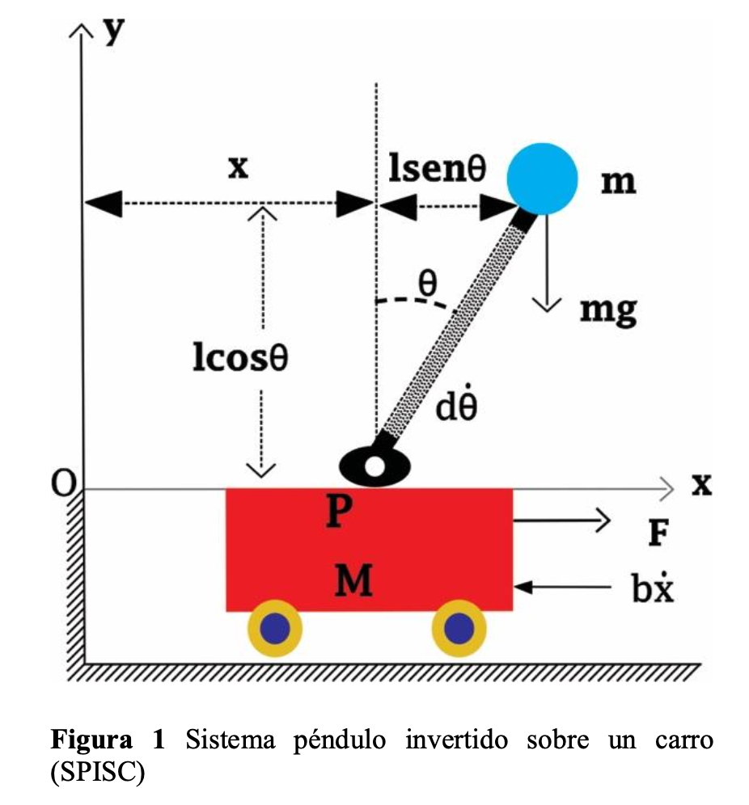
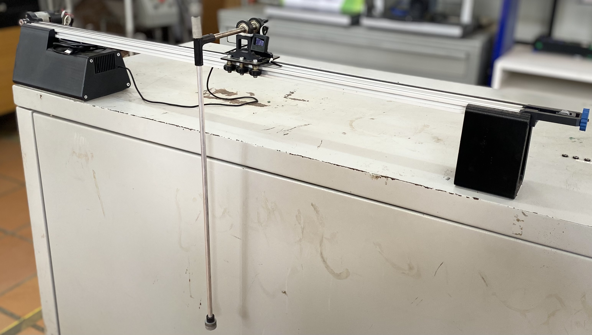
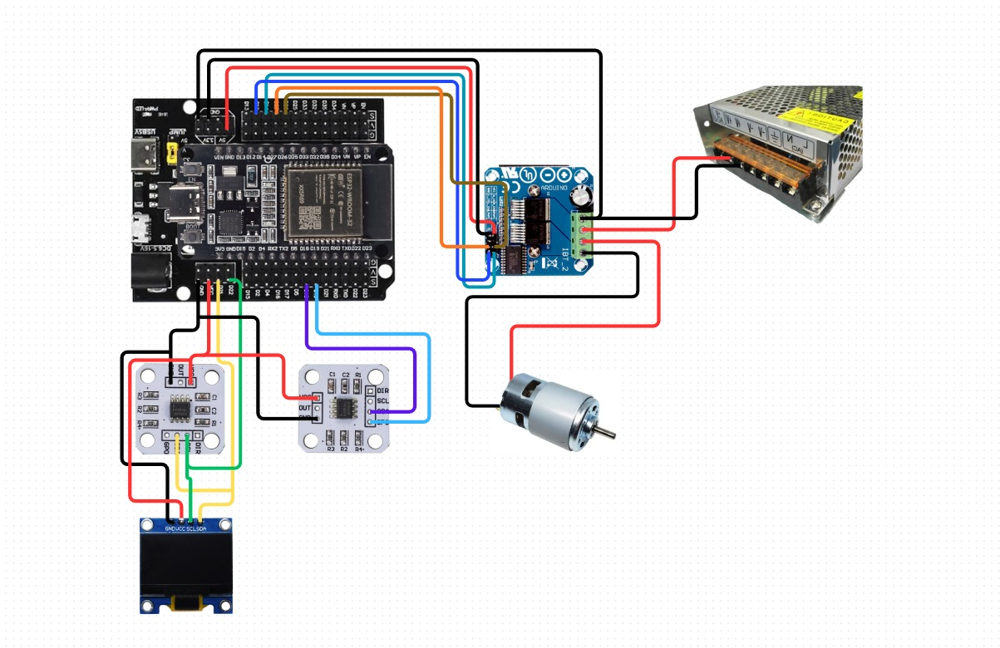

# Control Neuronal de Péndulo Invertido con Carro Móvil

## 1. Descripción General del Proyecto

Este proyecto implementa un sistema de control de péndulo invertido sobre carro móvil utilizando una **Red Neuronal Feed-Forward con entrenamiento en línea** ejecutándose en un **ESP32**. El objetivo es mantener un péndulo en posición vertical (180°) mediante el movimiento horizontal de un carro sobre un riel lineal de aluminio.

El sistema reemplaza un controlador PID clásico por una red neuronal que aprende en tiempo real, adaptándose continuamente a la dinámica no lineal del péndulo.

### Modelo Físico

El péndulo invertido se modela como un sistema de dos cuerpos:
- **Carro (masa $M$)**: se desplaza horizontalmente sobre el riel, accionado por un motor DC a través de una correa.
- **Péndulo (masa $m$, longitud $l$)**: pivotea libremente sobre el carro.



Las coordenadas del extremo del péndulo son:
$$x_p = x + l\sin\theta$$
$$y_p = l\cos\theta$$

Donde $\theta$ es el ángulo medido desde la vertical inferior, $x$ es la posición del carro y $F$ es la fuerza horizontal aplicada al carro.

---

## 2. Hardware del Sistema

### Componentes Principales

| Componente | Descripción | Conexión |
|---|---|---|
| **ESP32** | Microcontrolador principal (dual core, WiFi/BT) | — |
| **AS5600 #1** | Encoder magnético — ángulo del péndulo | I2C Bus 0 (SDA=21, SCL=22) |
| **AS5600 #2** | Encoder magnético — posición del carro | I2C Bus 1 (SDA=18, SCL=19) |
| **BTS7960** | Driver de motor DC (puente H doble) | R_EN=26, L_EN=27, R_PWM=14, L_PWM=12 |
| **Motor DC** | Actuador lineal del carro vía correa/polea | Conectado al BTS7960 |
| **OLED SSD1306** | Pantalla 128x64 para monitoreo | I2C Bus 0 (dirección 0x3C) |



### Diagrama de Pines

```text
ESP32
  ├── I2C Bus 0 (Wire 0)
  │     ├── SDA = GPIO 21
  │     ├── SCL = GPIO 22
  │     ├── AS5600 #1 (ángulo del péndulo)
  │     └── OLED SSD1306 (0x3C)
  │
  ├── I2C Bus 1 (Wire 1)
  │     ├── SDA = GPIO 18
  │     ├── SCL = GPIO 19
  │     └── AS5600 #2 (posición del carro)
  │
  └── Motor BTS7960
        ├── R_EN  = GPIO 26  (Enable derecho)
        ├── L_EN  = GPIO 27  (Enable izquierdo)
        ├── R_PWM = GPIO 14  (PWM derecho,  canal 0, 25kHz, 10 bits)
        └── L_PWM = GPIO 12  (PWM izquierdo, canal 1, 25kHz, 10 bits)
```



### Configuración PWM del Motor

- **Frecuencia**: 25 kHz (fuera del rango audible, reduce ruido del motor)
- **Resolución**: 10 bits (rango 0–1023)
- **Mapeo operativo**: la salida de la red neuronal se mapea al rango **200–800** del duty cycle, evitando velocidades muy bajas (donde el motor no tiene torque suficiente) y muy altas (que podrían desestabilizar el sistema).

---

## 3. Sensores AS5600

### Sensor 1 — Ángulo del Péndulo

Lee la posición angular absoluta del péndulo con resolución de 12 bits (0–4095).

```c++
anguloSensor1 = map(as5600_1.readAngle(), 0, 4095, 3600, 0) / 10.0;
```

- Se mapea e invierte el rango: de `[0, 4095]` a `[360.0°, 0.0°]`.
- El mapeo invertido indica que el sensor se montó tal que al girar en sentido horario, el ángulo disminuye.
- Resultado: ángulo en grados con un decimal de precisión.

### Sensor 2 — Posición del Carro

Lee la posición acumulativa (multi-vuelta) y la convierte a centímetros:

```c++
int32_t rawPos = as5600_2.getCumulativePosition();
// Detección de vuelta completa
if (delta < -2000) vueltas++;
if (delta > 2000)  vueltas--;

posicionAcumulada = (vueltas * 360) + map(rawPos, 0, 4095, 0, 360);
posicionCm = posicionAcumulada * CM_POR_GRADO;  // CM_POR_GRADO = 0.0115780
```

- Usa `getCumulativePosition()` con detección de salto para contar vueltas.
- El factor `CM_POR_GRADO = 0.0115780` convierte grados de la polea a centímetros lineales del carro (depende del diámetro de la polea/engranaje).
- **Período de muestreo**: 2 ms (500 Hz), controlado por `SAMPLE_PERIOD = 2000 µs`.

---

## 4. Constantes del Sistema

### Ángulo y Seguridad

| Constante | Valor | Descripción |
|---|---|---|
| `ANGLE_SETPOINT` | 180.0° | Objetivo: péndulo vertical hacia arriba |
| `MIN_ANGLE` | 135.0° | Límite inferior de operación (SETPOINT − 45°) |
| `MAX_ANGLE` | 225.0° | Límite superior de operación (SETPOINT + 45°) |

Si el ángulo sale de la banda `[135°, 225°]`, el motor se deshabilita inmediatamente como medida de seguridad.

### Posición del Carro

| Constante | Valor | Descripción |
|---|---|---|
| `posicionSetpoint` | 45.0 cm | Posición central del riel (punto de partida) |
| `MIN_POSITION` | 10.0 cm | Límite izquierdo del riel |
| `MAX_POSITION` | 85.0 cm | Límite derecho del riel |
| `ZONA_ALERTA` | 5.0 cm | Margen de alerta visual cerca de los límites |
| `MAX_POS_ADJUST` | 2.0 | Ajuste máximo de posición (reservado) |

---

## 5. Diagrama de Flujo del Sistema

```text
[ INICIO DEL SISTEMA ]
        │
        ▼
[ Configuración (setup) ]
  ├─ Inicializar Serial (115200)
  ├─ Configurar pines del motor (PWM y Enable)
  ├─ Inicializar buses I2C y sensores AS5600
  ├─ Inicializar pantalla OLED
  └─ Configurar y entrenar Red Neuronal (Feed Forward)
        │
        ▼
[ Fase de Posicionamiento Inicial ]
  ├─ Leer sensores cada 2ms
  ├─ Mover el carrito hacia adelante (PWM = 280)
  └─ ¿Llegó a 45.0 cm? ──(NO)──> Bucle de espera
             │
           (SÍ)
             ▼
      Frenar motor + delay(5s)
        │
        ▼
[ BUCLE PRINCIPAL (loop) ] <─────────────────────────────────────┐
        │                                                        │
        ▼                                                        │
[ Leer Sensores (cada 2ms) ]                                     │
  └─ Actualizar ángulo y posición acumulada                      │
        │                                                        │
        ▼                                                        │
[ Verificación de Seguridad ]                                    │
  └─ ¿Ángulo fuera de [135°, 225°]?                              │
        ├─ (SÍ) -> Apagar motor, Frenar, Estado = "DETENIDO"     │
        └─ (NO) -> Habilitar motor                               │
        │                                                        │
        ▼                                                        │
[ Control de Movimiento (Si motor está habilitado) ]             │
  ├─ ¿Fase Inicial completada (Péndulo levantado)?               │
  │     ├─ (NO) -> Swing-Up: mover carro hacia límites           │
  │     └─ (SÍ) -> Pasar control a la Red Neuronal               │
  │                                                              │
  ▼                                                              │
[ Control Neuronal ]                                             │
  ├─ Calcular Error (180° − Ángulo actual)                       │
  ├─ Alimentar red: [error, Δerror, Δ²error]                     │
  ├─ Entrenamiento en línea (TRAIN_NET_ONLINE)                   │
  ├─ Obtener salida (Output) → mapear PWM (200–800)              │
  └─ Actualizar historial: error_2 = error_1, error_1 = error    │
        │                                                        │
        ▼                                                        │
[ Accionamiento del Motor ]                                      │
  ├─ ¿error > +0.01? ──> motorAdelante()                         │
  ├─ ¿error < −0.01? ──> motorAtras()                            │
  └─ Sino ─────────────> motorFreno()                            │
        │                                                        │
        ▼                                                        │
[ Actualizar Interfaz ]                                          │
  ├─ Refrescar Pantalla OLED (Ángulo, Posición, PWM, Alertas)    │
  └─ Enviar estado por Puerto Serial                             │
        │                                                        │
        ▼                                                        │
[ delay(10ms) ] ─────────────────────────────────────────────────┘
```

---

## 6. Funciones del Motor

El driver BTS7960 se controla con 4 señales: dos enables (R_EN, L_EN) que permanecen siempre en HIGH, y dos señales PWM para cada sentido de giro:

```c++
void motorAdelante() {
  ledcWrite(1, 0);          // Canal L apagado
  ledcWrite(0, motorSpeed); // Canal R con velocidad
}

void motorAtras() {
  ledcWrite(0, 0);          // Canal R apagado
  ledcWrite(1, motorSpeed); // Canal L con velocidad
}

void motorFreno() {
  ledcWrite(0, 0);  // Ambos canales a 0 → frenado por cortocircuito
  ledcWrite(1, 0);
}
```

La dirección del motor se determina por el **signo del error angular**:
- `error > +0.01` → el péndulo está inclinado hacia un lado → mover carro adelante.
- `error < −0.01` → inclinado al lado opuesto → mover carro atrás.
- `|error| ≤ 0.01` → zona muerta → frenar (evita oscilaciones de alta frecuencia).

---

## 7. Fase de Swing-Up (Levantamiento del Péndulo)

Antes de que la red neuronal tome el control, existe una fase para llevar el péndulo desde su posición colgante hasta la zona de equilibrio. Esta lógica se activa cuando `initialPositionReached == false`:

```c++
// Si el péndulo está en [0°, 135°) → está cayendo por un lado
if (anguloSensor1 > 0 && anguloSensor1 < MIN_ANGLE) {
  front = MIN_ANGLE - anguloSensor1;
  front = map(front, MIN_ANGLE, 0, 1, 0);
  motorSpeed = 500 * front;
  motorAtras();
}
// Si el péndulo está en (225°, 360°) → está cayendo por el otro lado
else if (anguloSensor1 > MAX_ANGLE && anguloSensor1 < 360) {
  back = anguloSensor1 - MAX_ANGLE;
  back = map(back, MAX_ANGLE, 0, 1, 0);
  motorSpeed = 500 * back;
  motorAdelante();
}
// Si entra en [135°, 225°] → la red neuronal toma el control
else {
  initialPositionReached = true;
}
```

La velocidad del motor se escala proporcionalmente a la distancia entre el ángulo actual y la zona de control, con un máximo de `500` de PWM. Una vez que el péndulo entra en la ventana de ±45° alrededor del setpoint, la bandera `initialPositionReached` se activa y el control pasa a la red neuronal.

---

## 8. Explicación del Lazo de Control Neuronal

Lo que tenemos aquí no es un simple control PID tradicional, sino una **Red Neuronal Prealimentada (Feed-Forward)** que aprende y se ajusta en tiempo real (lo que se conoce como *Online Training* o entrenamiento en línea). El sistema toma la dinámica del error del péndulo para decidir cuánta energía (PWM) enviar a los motores para mantenerlo en equilibrio.

### 8.1. Arquitectura de la Red Neuronal

```text
          ┌─────────────┐     ┌──────────────┐     ┌─────────────┐
          │  CAPA DE     │     │  CAPA OCULTA │     │  CAPA DE    │
          │  ENTRADA     │     │              │     │  SALIDA     │
          │              │     │              │     │             │
 error ──►│  Neurona 1   │──┬─►│  Neurona 1   │──┬─►│  Neurona 1  │──► Output
          │  (logsig)    │  │  │  (logsig)    │  │  │ (poslin_lim)│    (PWM)
          │              │  │  │              │  │  │             │
Δerror ──►│  Neurona 2   │──┤  │  Neurona 2   │──┤  └─────────────┘
          │  (logsig)    │  │  │  (logsig)    │  │
          │              │  │  │              │  │
Δ²error──►│  Neurona 3   │──┘  │  Neurona 3   │──┘
          │  (logsig)    │     │  (logsig)    │
          └─────────────┘     └──────────────┘

Estructura: [3] → [3] → [1]
```

**Código de configuración:**

```c++
// Se define una red de 3 capas (Entrada, Oculta, Salida)
byte L = 3;

// Vector de estructura: [Entradas, Neuronas Capa Oculta, Salidas]
float V[] = {(float)XC, 3.0, (float)DF};  // [3, 3, 1]

// Funciones de activación para cada capa
const char *myStrings[] = {"logsig", "logsig", "poslin_lim"};

// Tasa de aprendizaje
net.LearningRate = 0.4;

// Se construye la red con estos parámetros
net.FEED_FORWARD_NET(EST, FAC_STR);
```

### 8.2. Las Funciones de Activación

| Capa | Función | Comportamiento |
|---|---|---|
| Entrada | `logsig` | Sigmoide logarítmica: $f(x) = \frac{1}{1+e^{-x}}$, comprime la entrada al rango $(0, 1)$ |
| Oculta | `logsig` | Misma sigmoide, permite representaciones no lineales |
| Salida | `poslin_lim` | Lineal positiva limitada: salida acotada entre 0 y 1, configurada con `dposlin_limits(1, 0)` |

La combinación de sigmoides en capas internas con salida lineal limitada es clásica en problemas de control: las capas internas capturan la no linealidad del sistema, mientras que la salida genera un valor suave y acotado directamente utilizable como señal de control.

### 8.3. Entradas de la Red (Inspiración PID Discreto)

```c++
float angleControl(float currentAngle) {
  error = ANGLE_SETPOINT - currentAngle;

  // ALIMENTAMOS LAS 3 ENTRADAS DE LA RED (Matriz XI):
  XI.WriteArray_2D(0, 0, error);              // Componente Proporcional
  XI.WriteArray_2D(0, 1, error - error_1);    // Componente Derivativa (1er orden)
  XI.WriteArray_2D(0, 2, error_1 - error_2);  // Componente Derivativa (2do orden)

  net.NORMALIZE_DATA(XI, 1000.00);            // Normalización

  D.WriteArray_2D(0, 0, ANGLE_SETPOINT / 1000.00);  // Salida deseada

  net.TRAIN_NET_ONLINE(XI, D, posicion);      // Entrenamiento + inferencia

  Output = net.y.ReadArray_2D(net.y.GetRows() - 1, 0);
  return Output * 1000.00;
}
```

Las tres entradas codifican información equivalente a un controlador PID discreto:

| Entrada | Expresión | Analogía PID | Significado Físico |
|---|---|---|---|
| `XI[0]` | $e(k)$ | **Proporcional** | ¿Cuánto se desvía el péndulo del setpoint? |
| `XI[1]` | $e(k) - e(k-1)$ | **Derivativo** (velocidad) | ¿A qué velocidad está cayendo o recuperándose? |
| `XI[2]` | $e(k-1) - e(k-2)$ | **Derivativo 2do orden** (aceleración) | ¿Se está acelerando o frenando la caída? |

### 8.4. El Aprendizaje en Tiempo Real (Online Training)

Esta es la característica más avanzada del código. A diferencia de sistemas de IA que se entrenan offline en grandes datasets, esta red **aprende mientras funciona**, en cada ciclo del loop:

1. **Observa**: Toma los 3 datos de entrada (error, velocidad del error, aceleración del error).
2. **Actúa**: Genera una salida (`Output`) basándose en los pesos actuales de la red.
3. **Se Corrige**: La función `TRAIN_NET_ONLINE` compara la posición actual (`posicion`) con la posición deseada (`D`) y utiliza la tasa de aprendizaje (0.4) para ajustar los pesos sinápticos al instante vía retropropagación del error.

**Tasa de aprendizaje (`LearningRate = 0.4`):**
- Es un valor relativamente alto, lo que permite reacción rápida ante perturbaciones.
- El compromiso: tasas altas permiten adaptación veloz, pero pueden causar oscilaciones si la red sobrecompensa. Es un hiperparámetro que requiere ajuste experimentalmente.
- Nota: en el `setup()`, la red se inicializa primero con `LearningRate = 0.0` (sin aprendizaje) para estabilizar los pesos iniciales, y luego se cambia a `0.4` antes de entrar al loop.

**Normalización:** Tanto las entradas como la salida deseada se normalizan dividiéndolas por 1000, manteniendo los valores en rangos pequeños que las funciones sigmoide procesan eficientemente (evitando la saturación).

### 8.5. Diagrama de Flujo del Control Neuronal

```text
                 ┌──────────────────┐
                 │   Ángulo actual   │
                 │   (anguloSensor1) │
                 └────────┬─────────┘
                          │
                          ▼
              ┌───────────────────────┐
              │  error = 180° − ángulo │
              └───────────┬───────────┘
                          │
                ┌─────────┼─────────┐
                ▼         ▼         ▼
           ┌────────┐ ┌───────┐ ┌────────┐
           │ e(k)   │ │ Δe(k) │ │ Δ²e(k) │
           └───┬────┘ └───┬───┘ └───┬────┘
               │          │         │
               ▼          ▼         ▼
          ┌──────────────────────────────┐
          │     Normalizar (÷ 1000)      │
          └──────────────┬───────────────┘
                         │
                         ▼
          ┌──────────────────────────────┐
          │  Red Neuronal [3]→[3]→[1]    │
          │  TRAIN_NET_ONLINE            │
          │  (Forward pass + Backprop)   │
          └──────────────┬───────────────┘
                         │
                         ▼
          ┌──────────────────────────────┐
          │  Output × 1000 → motorSpeed  │
          │  map(0–1000) → PWM(200–800)  │
          └──────────────┬───────────────┘
                         │
           ┌─────────────┼──────────────┐
           ▼             ▼              ▼
      error > 0.01  |error| ≤ 0.01  error < -0.01
      ADELANTE        FRENO          ATRÁS
```

---

## 9. Mecanismos de Seguridad

El sistema implementa múltiples capas de protección:

### 9.1. Límites de Ángulo
Si el péndulo se sale de la ventana de ±45° (es decir, fuera de `[135°, 225°]`), el motor se desactiva completamente:

```c++
if (anguloSensor1 < MIN_ANGLE || anguloSensor1 > MAX_ANGLE) {
  motorEnabled = false;
  motorFreno();
  motorDirection = "DETENIDO";
}
```

Esto previene que el motor intente compensar un péndulo que ya está en caída libre, evitando daños al hardware o movimientos peligrosos del carro.

### 9.2. Zona Muerta del Error
La banda muerta de `±0.01` en el error evita que el motor conmute de dirección a alta frecuencia (chattering) cuando el péndulo está casi en equilibrio:

```c++
if (error > 0.01)       → motorAdelante()
else if (error < -0.01) → motorAtras()
else                    → motorFreno()
```

### 9.3. Zona Crítica de Posición
La pantalla OLED muestra una alerta visual `"!ZONA CRIT!"` cuando el carro se acerca a los extremos del riel:

```c++
if ((posicionCm < (MIN_POSITION + ZONA_ALERTA)) ||
    (posicionCm > (MAX_POSITION - ZONA_ALERTA))) {
  // Alerta: carro a menos de 5 cm del límite
}
```

---

## 10. Interfaz de Monitoreo

### 10.1. Pantalla OLED

La pantalla muestra en tiempo real:

```text
┌────────────────────────────┐
│ Angulo:        [ESTADO]    │
│   173.5°                   │
│               PWM: 450     │
│               !ZONA CRIT!  │
│ Posicion:                  │
│   43.2cm      Dir:         │
│               ADELANTE     │
└────────────────────────────┘
```

Donde `[ESTADO]` puede ser:
- **`ALERTA`**: motor deshabilitado por ángulo fuera de rango.
- **`INICIAL`**: en fase de swing-up.
- **`VERTICAL`**: red neuronal controlando activamente.

### 10.2. Puerto Serial

El sistema envía telemetría continua a 115200 baud con formato:

```
error: -2.30 | error1: -1.80 | error2: -1.20 | PWM: 350 | Output: 0.45 | back: 0.00 | front: 0.00 | anguloSP: 0.00 | Estado: VERTICAL
```

---

## 11. Secuencia de Inicialización (Setup)

El `setup()` ejecuta los siguientes pasos en orden:

1. **Serial**: Se inicia a 115200 baud para depuración.
2. **Motor**: Se configuran los pines Enable como salida y se activan (HIGH). Se configuran los canales PWM (25 kHz, 10 bits) en los pines R_PWM y L_PWM.
3. **I2C**: Se inicializan los dos buses I2C y se resetean ambos sensores AS5600.
4. **OLED**: Se inicia la pantalla; si falla, el programa se detiene.
5. **Red Neuronal**:
   - Se crean las matrices de entrada `XI` (1×3) y salida deseada `D` (1×1).
   - Se define la estructura `[3, 3, 1]` y las funciones de activación.
   - Se construye la red con `LearningRate = 0.0` (sin aprendizaje inicial).
   - Se cambia a `LearningRate = 0.4` para el control activo.
6. **Posicionamiento**: Se mueve el carro hasta 45 cm a velocidad constante (PWM = 280) y luego se frena con una pausa de 5 segundos para estabilizar el sistema.

---

## 12. Librerías Utilizadas

| Librería | Propósito |
|---|---|
| `Arduino.h` | Core de Arduino para ESP32 |
| `Neural_Networks_FF.h` | Red neuronal Feed-Forward con entrenamiento online |
| `Adafruit_GFX.h` | Primitivas gráficas para pantalla |
| `Adafruit_SSD1306.h` | Driver para pantalla OLED SSD1306 |
| `AS5600.h` | Driver para encoder magnético AS5600 |

La librería `Neural_Networks_FF` proporciona las clases `Neural_Networks_FF` (red neuronal) y `Dynamic_Array` (matrices dinámicas), permitiendo crear, entrenar y ejecutar redes neuronales directamente en el microcontrolador.

---

## 13. Objetos y Estructuras de Datos

| Objeto | Tipo | Dimensión | Propósito |
|---|---|---|---|
| `net` | `Neural_Networks_FF` | — | Red neuronal principal |
| `EST` | `Dynamic_Array` | 1×3 | Vector de estructura de capas `[3, 3, 1]` |
| `FAC_STR` | `Dynamic_Array` | 1D, 3 elementos | Funciones de activación por capa |
| `XI` | `Dynamic_Array` | 1×3 | Entradas de la red: `[e, Δe, Δ²e]` |
| `D` | `Dynamic_Array` | 1×1 | Salida deseada (setpoint normalizado) |
| `posicion` | `Dynamic_Array` | 1×1 | Posición actual normalizada (para el entrenamiento) |
| `as5600_1` | `AS5600` | — | Sensor de ángulo del péndulo |
| `as5600_2` | `AS5600` | — | Sensor de posición del carro |
| `display` | `Adafruit_SSD1306` | 128×64 | Pantalla OLED |

---

## 14. Temporización del Sistema

| Tarea | Período | Modo |
|---|---|---|
| Lectura de sensores | 2 ms (500 Hz) | Polling con `micros()` |
| Loop principal | ~10 ms (~100 Hz) | `delay(10)` al final del loop |
| Pantalla OLED | Cada ciclo del loop | Dentro del loop principal |
| Serial | Cada ciclo del loop | Dentro del loop principal |

La lectura de sensores a 500 Hz garantiza una resolución temporal suficiente para capturar la dinámica del péndulo, mientras que el loop principal a ~100 Hz (considerando el overhead de la red neuronal) permite un control responsivo.
